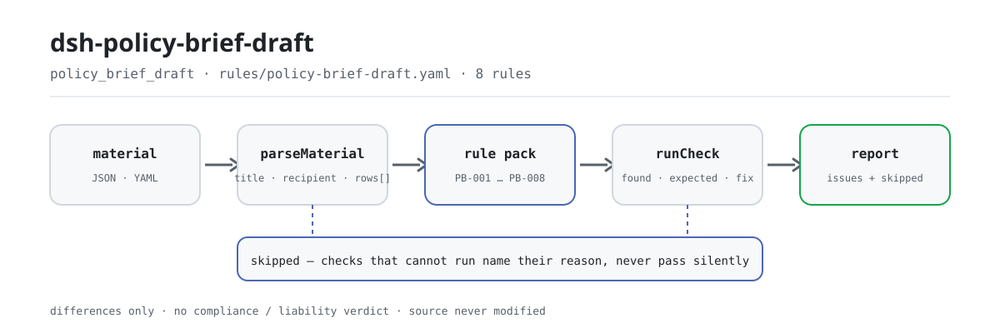

<div align="center">

<picture>
  <source media="(prefers-color-scheme: dark)" srcset="docs/assets/dsh-policy-brief-draft-flow-dark.svg">
  
</picture>

# dsh-policy-brief-draft

**Check a policy brief element by element — completeness and data freshness — and get back which row, which column and what is missing, with the verdict left to the reviewer.**

A DeepSeek Harness checker for policy researchers and drafting offices: give it a policy-brief element checklist (a document header plus one row per section), and a rule pack with verbatim citations (PB-001…PB-008) lists only the differences the material itself can point to — the source is never modified, it makes no network request and calls no model.

[Install](#three-step-setup) · [Configuration](#configuration) · [FAQ](#faq) · [简体中文](README.md) · [English](README.en.md) · [Español](README.es.md) · [Português](README.pt.md) · [हिन्दी](README.hi.md)

[](LICENSE)
[](#compatibility)
[](https://www.npmjs.com/package/dsh-policy-brief-draft)
[](https://github.com/PerryLink/dsh-policy-brief-draft/actions/workflows/ci.yml)
[](#compatibility)

[](https://github.com/PerryLink/dsh-policy-brief-draft/stargazers)
[](https://www.npmjs.com/package/dsh-policy-brief-draft)
[](https://dshfind.com/plugins/PerryLink/dsh-policy-brief-draft?ref=badge)
[](https://securityscorecards.dev/viewer/?uri=github.com/PerryLink/dsh-policy-brief-draft)
[](https://dsh.market/)
[](https://gitee.com/perrylink/dsh-policy-brief-draft)

```sh
dsh plugin --profile <name> add dsh-policy-brief-draft
```

</div>

<sub>Community plugin, not affiliated with DeepSeek. Canonical repository: <https://github.com/PerryLink/dsh-policy-brief-draft> (Gitee is a mirror).</sub>

## What it is

`dsh-policy-brief-draft` reads one policy-brief (or research-report) element checklist — the document header plus one row per section — and checks that checklist's own completeness and internal consistency: that each section states its point, that a point carries supporting evidence, that the evidence cites a source, that the data cutoff parses and is not later than the review date, that the figures fall inside the data-freshness window you configure, that a recommendation names who would implement it, that the header declares the brief's title and its recipient, and that no section number is repeated. It returns the list of what is inconsistent, where, and what to fix; the source file is never modified, it makes no network request and calls no model. It does not decide whether a point is right, whether the evidence is sufficient, whether a recommendation is feasible, whether the data is reliable, or whether the brief should be submitted: those are judgements about research quality and decision value, and they are deliberately out of scope.

## Three-step setup

1. **Install**:

   ```sh
   dsh plugin --profile <name> add dsh-policy-brief-draft
   ```

   You can also search "Documents and Governance Suite" in WorkBuddy / Coze (this check is one part of it; availability as listed in that marketplace).

2. **Minimal config** (the defaults just work):

   ```yaml
   - insert:
       - id: dsh-policy-brief-draft
         name: dsh-policy-brief-draft
   ```

   Every tunable lives in the Schemastery schema in `src/config.ts`, and the defaults are usable as shipped; per-rule thresholds live in the rule pack under `rules/`.

3. **Verify it mounts**:

   ```sh
   dsh --profile <name> --dump-config | grep 'dsh-policy-brief-draft'
   ```

   Then run the bundled sample once (about a minute):

   ```sh
   node samples/quickstart/run.mjs
   ```

   ```text
   $ node samples/quickstart/run.mjs
   policy_brief_draft: 1 issue(s) — error 1, warn 0, info 0
   skipped: 2
   ```

   The sample input is in `samples/quickstart/input/`, the expected output in `samples/quickstart/expected/result.json`, and the first-run terminal screenshot in [`docs/assets/quickstart.png`](docs/assets/quickstart.png).

**Uninstall**: `dsh plugin --profile <name> remove dsh-policy-brief-draft` (or remove the row from the profile patch).

## Core capabilities

The plugin registers the `policy_brief_draft` tool: it reads one brief element checklist (header plus one row per section), applies a versioned rule pack, and returns a structured report. Material is JSON or YAML; a check that cannot run is listed in `skipped` with its reason.

- **The rule pack is data** — all 8 checks live in `rules/policy-brief-draft.yaml`, so switching the rule set needs no code change; the pack is validated on load, not trusted.
- **Severity follows the evidence** — a rule derived from a principle (`derived-from-principle`) is capped at `warn`, and one whose threshold comes from institutional configuration (`institutional-configuration`) is capped at `info`; a principle or a local configuration is never labelled `error` (a test asserts this).
- **An empty issue list is not "all clear"** — every check that cannot run reports itself in `skipped` with its reason; `PB-005` ships with `maxDays: 0`, so it reports itself in `skipped` instead of passing silently.
- **No adjudication** — the report lists differences and never pronounces on compliance, liability or correctness; a wording guard forces every report to carry the disclaimer.
- **No fabricated citations** — every rule carries `document` / `number` / `clause` / `excerpt` / `kind` / `source`; `excerpt` must be a verbatim quotation, and when the text is not in hand the pack says so instead of presenting a paraphrase as a quotation.

```text
brief checklist (JSON/YAML) ──policy_brief_draft──▶ rule pack PB-001…PB-008 ──▶ report (issues + skipped)
          ▲                                                                              │
          └───────────────────────── source is read-only, never modified ────────────────┘
```

### Rules at a glance

| Rule | What it checks | Severity | Basis kind |
|---|---|---|---|
| `PB-001` | each section states its point | error | verbatim clause |
| `PB-002` | each point has supporting evidence | warn | derived principle |
| `PB-003` | the evidence cites a source | error | verbatim clause |
| `PB-004` | the data cutoff parses and is not in the future | error | verbatim clause |
| `PB-005` | the data is fresh enough under your window (off by default) | info | institutional configuration |
| `PB-006` | a recommendation names its implementer | warn | derived principle |
| `PB-007` | the brief names its title and recipient | warn | verbatim clause |
| `PB-008` | section numbers are unique in the table | warn | derived principle |

### Examples

These are the plugin's real entry points; install once, then call one. The output below is the plugin's real run against its own `PB-001` test fixture, not an illustration.

**Detailed output** — tool `policy_brief_draft`, input:

```json
{"title":"某某领域投资形势分析专报","rows":[{"序号":"1","章节":"一、现状","核心观点":"","支撑依据":"全国固定资产投资统计月报（2026 年 2 月）显示本领域投资同比增长 3.1%"}]}
```

Output:

```json
{
  "id": "dsh-policy-brief-draft.PB-001.de09b5a6",
  "ruleId": "PB-001",
  "severity": "error",
  "locator": {
    "row": 1,
    "field": "point"
  },
  "found": "第 1 行「point」为空",
  "expected": "「point」应填写",
  "fix": "补填核心观点；本条只核对是否写明，不判断观点是否成立"
}
```

*Observed from `dsh-policy-brief-draft/tests/fixtures/PB-001/PB-001-unsafe.json (cases.json expects 1×PB-001); executed parseMaterial+runCheck, checkedAt=2026-10-06T00:00:00.000Z`*

### What it answers

| You ask | What it answers |
|---|---|
| One section is all material and no conclusion: the point column is empty. | `PB-001` reports that section, because every section is expected to state its point. It checks only that the `point` cell is filled, so it does not judge whether the point is right or whether it says anything new. It is an `error`: article 19(3) requires a "clear point of view", and that article was read verbatim on 2026-10-13. |
| We filled in the evidence column and the source column. What does the check actually verify? | Only that both cells are filled. `PB-002` requires `evidence` for every point and `PB-003` requires `sourceRef` beside it. `PB-003` is an `error`, because article 20(4) lists "whether quotations and the like are accurate" among the review points before a document is issued; `PB-002` stays a `warn`, because no article requires one citation per point. `PB-002` does not judge whether the evidence is sufficient, real, or actually supports the point; `PB-003` cannot check that the source exists or that the figures match it, because the plugin reads the checklist and never the sources, so a fabricated citation passes. |
| The data cutoff reads `2026-03-15 09:30`, and one section carries a date later than today. | Both `2026-03-15` and `2026-03-15 09:30` are read. `PB-004` reports a `dataAsOf` that falls after the review date, meaning either the date was filled in wrongly or the section cites data that does not exist yet, and a value it cannot parse is reported on its own instead of being silently skipped. It is an `error`: article 19(2) requires that analysis be fact-based and article 20(4) requires the "time" to be accurate, and a cutoff after the review date cannot be true. It does not judge whether the data itself is reliable. |
| The freshness rule reports `skipped`. Does that mean the data is fine? | No. `PB-005` ships with `maxDays: 0`, which means unconfigured, so it reports itself in `skipped` rather than inventing a number; set `maxDays` (for example `maxDays: 90`) to switch it on. A hit then means only that the data is older than the window you set, never that it is unusable, and citing older data is sometimes right, so say why in the remark. The rule is `info`: its day window is your editorial convention and the regulation fixes no number of days. |
| A section makes a recommendation but never says who would carry it out. | `PB-006` reports that section: once the `recommendation` cell is filled, the `implementer` cell is required. A section that only analyses the current situation and makes no recommendation is not reported, so the rule does not nag status-only sections. It checks that the implementer is named, not whether the recommendation is feasible or that body the right one. |
| What must the brief itself declare, and may the same section number appear twice? | `PB-007` requires the header to declare both `title` and `recipient`, and further header fields such as classification or topic can be added to its `fields` if your own form records them. `PB-008` reports a `sectionNo` that appears twice in the table, ignoring whitespace, because a repeated number stops a reviewer from pointing at one point unambiguously. `PB-007` checks only that those header cells are filled, not that the title is apt or the recipient the right body, and `PB-008` compares the numbers alone. |

## Configuration

Every tunable lives in the Schemastery schema in `src/config.ts`, so it can be changed from `cordis.yml` without editing code; per-rule thresholds live in the rule pack under `rules/`. There are exactly five configuration keys, in the table below; rule-level parameters follow it.

| Key | Type | Default | Description |
|---|---|---|---|
| `rulesFile` | string | `rules/policy-brief-draft.yaml` | Rule-pack path, relative to the package root |
| `disabledRules` | string[] | `[]` | Rule ids to stop running; each appears in `skipped` |
| `onlyRules` | string[] | `[]` | Run only these rule ids; empty runs every rule |
| `skipNotes` | string | `""` | Note appended to every `skipped` reason |
| `timeoutMs` | number | `120000` | Cooperative tool timeout budget (milliseconds) |

Rule-level parameters worth knowing:

- `PB-005` `maxDays` — your freshness window in days. `0` means the rule does not run, and appears in `skipped`.
- `PB-006` `conditionField` / `requiredFields` — what triggers the implementer requirement; the recommendation column by default. Sections that analyse without recommending are not asked for one.
- `PB-007` `fields` — the header fields that must be present; title and recipient by default. Add `classification` if your briefs carry a security marking.

## FAQ

<details>
<summary>Will my material be modified or uploaded?</summary>

No. The tool only reads the JSON/YAML material text you hand it and **never modifies the source file**; the plugin is plain ESM, has no native code, **makes no network request and calls no model** (see "Compatibility"), so the material never leaves your machine.

</details>

<details>
<summary>With no freshness window configured, will it pass silently?</summary>

No. `PB-005` ships with `maxDays` unset (`0`), so the rule reports itself in `skipped` with its reason — an empty issue list cannot be read as "nothing missing". Configure `maxDays` and it starts running; after that, a hit means the data is older than the window you set, never that the data is unusable.

</details>

<details>
<summary>The plugin installs but the tool never appears. What now?</summary>

Check that `main` points to `lib/index.mjs` and that `pnpm run build` produced it; a wrong `main` makes the loader skip the entry silently.

</details>

<details>
<summary>The install is rejected as incompatible. What now?</summary>

The peer range covers `0.1.x` and `0.2.x`; if your runtime sits outside it, grant an explicit exemption: `dsh plugin --profile <name> allow-version dsh-policy-brief-draft@0.1.0 --dsh-version <runtime> --accept-risk`. The runtime enforces peer compatibility at install time.

</details>

<details>
<summary>Can it handle a whole brief, or a directory of them, in one run?</summary>

The tool works in `native` and `ptc` mode; for a large set of documents prefer `ptc`, so the schema cost is paid once. All arithmetic is wall-clock arithmetic on the supplied strings, with no time-zone conversion.

</details>

## Standards it follows

| Document | Number | Cited by rules |
|---|---|---|
| Regulations on the Handling of Official Documents in Party and Government Organs | Zhongbanfa [2012] No. 14 (full text obtained; the verbatim clause is now back-filled into each rule's `excerpt`) | PB-001, PB-002, PB-003, PB-004, PB-005, PB-006, PB-007, PB-008 |

**Boundary:** this plugin checks a **policy-brief element checklist** for what such a checklist can be held to mechanically — that each section states its point, that a point has supporting evidence, that the evidence cites a source, that the data cutoff parses and is not in the future, that the figures are fresh enough under your window, that a recommendation names who would implement it, that the brief names its title and recipient, and that section numbers are unique. It does **not** decide whether a point is right, whether the evidence is sufficient, whether a recommendation is feasible, whether the data is reliable, or whether the brief should be submitted. **Those are judgements about research quality and decision value.**

> ### ⚠️ What this plugin can and cannot see
>
> **It reads a checklist, not the sources or the data.** So it can only check that a source is *cited* — never that the source exists or that the figures match it. `PB-003` says so in its own note, and the README's troubleshooting section repeats it: a fabricated citation will pass, because verifying sources is a different job.
>
> **The regulation (Zhongbanfa [2012] No. 14) was obtained and read verbatim**, and `rules/evidence/clause-verification.md` records which articles were quoted — article 8(10) (a report serves to brief a superior body), article 19 (drafting: "analysis shall be fact-based", "the policies and measures proposed shall be practicable", "the point of view shall be clear") and article 20(4), which lists the accuracy of "quotations and the like" as a review point before issuance.
>
> **The clause text is now in the pack, and the severities were re-derived from it (2026-10-13).** The regulation governs how a document is *drafted and issued*; this plugin checks whether a brief's *outline* records its points, evidence, sources and recommendations. Those are two different things, so the rule was applied article by article rather than in bulk:
>
> - **Raised to `error`** where an article states the requirement the check looks for: `PB-001` (19(3), a clear point of view), `PB-003` (20(4) lists the accuracy of quotations as a pre-issuance review point) and `PB-004` (19(2), fact-based analysis, with 20(4), accurate time — a cutoff after the review date cannot be true).
> - **Left at `warn` even though the text was obtained**, because the article is about something else: `PB-002` (no article requires one citation per point), `PB-006` (none requires naming an implementer), `PB-008` (none requires unique section numbers), and **`PB-007`**, whose article 9 governs the eighteen format elements of a formal document rather than two columns of a working outline — calling a blank header cell a `direct` breach of article 9 would dress a register gap up as a regulatory one.
> - **Still `info`**: `PB-005`, whose window is your editorial convention and is not in the regulation at all.
>
> So **3 rules are `error`, 4 are `warn` and 1 is `info`** — the split is the point, not a compromise: obtaining a text licenses a `direct` citation only where the text actually says the thing being checked. See `rules/evidence/clause-verification-gongwen-tiaoli-direct.md`, which also records where it disagrees with the earlier analysis in `clause-verification.md`.
>
> **The data-freshness window ships unset.** How stale is too stale is your editorial rule — a quick brief may demand last month's figures while an annual analysis legitimately cites the year's data — so `PB-005`'s `maxDays` starts at `0` and the rule reports itself in `skipped` rather than inventing a number. A finding there means "older than the window you set", never "unusable"; citing older data is sometimes right, and the fix is to say why in the remark.

## Material format

The tool accepts JSON or YAML:

```yaml
title: 某某领域投资形势分析专报
topic: 投资形势
recipient: 某某部门
draftedAt: 2026-03-12
classification: 内部
rows:
  - { 序号: '1', 章节: 一、现状,
      核心观点: 本领域投资增速连续三个季度回落，结构性分化明显,
      支撑依据: 全国固定资产投资统计月报（2026 年 2 月）显示本领域投资同比增长 3.1%,
      出处: 国家统计局月度数据，2026 年 3 月发布, 数据截止日期: 2026-02-28,
      风险提示: 月度数据存在季节因素，需结合同比口径判断 }
```

Column names are matched case-insensitively and ignoring spaces, underscores and hyphens; the checklist's own column names are kept, so a finding names the column it read. Dates may be `2026-02-28` or `2026-02-28 09:30`. Fields are optional at the reading layer and validated by the check engine, so a partial export produces findings about what is missing instead of crashing.

## Rule sources

Rule data lives in `rules/policy-brief-draft.yaml`, separate from the code. Every rule carries the document, its number, the clause in the source's own numbering, a verbatim `excerpt`, a source URL and a basis kind (`kind`). The load-time guard enforces that an `excerpt` is a real quotation of at least eight characters, and that a check based only on a derived principle (`derived-from-principle`, severity capped at `warn`) or on institutional configuration (`institutional-configuration`, capped at `info`) is never labelled `error`. A pack that overstates its basis fails at load instead of producing a confident-looking report.

The cited clauses come from the Regulations on the Handling of Official Documents in Party and Government Organs (Zhongbanfa [2012] No. 14): article 8(10), article 9 (including (7) title and (8) principal recipient), article 19(2)(3) and article 20(4). The boundaries confirmed during verification, and the conclusions deliberately not drawn, are recorded in `rules/evidence/`, in particular `clause-verification-gongwen-tiaoli-direct.md` and `clause-verification.md`.

## Compatibility

| Surface | Status |
|---|---|
| Harness | Peer range `>=0.1.2-rc.1 <0.2.0 \|\| >=0.2.0-0 <0.3.0` — verified to accept both `0.2.0-rc.2` and `0.2.1-rc.2`. `engines.dsh` is declared as `>=0.2.1-0 <0.3.0` and is enforced by the host since 0.2.1 |
| Node | `^22.19.0 \|\| >=24.0.0` |
| Platforms | All (plain ESM; no native code, no network, no model call) |
| Tool mode | Works in `native` and `ptc`; for a long checklist use `ptc` |

## Troubleshooting

- **`PB-005` never runs.** The freshness window is empty (`maxDays: 0`). How stale is too stale is your editorial rule, and the plugin will not invent one; configure `maxDays` (for example `90`) to switch it on.
- **`PB-003` passes a source I know is invented.** It cannot check that: it verifies a source is *cited*, not that it exists or says what the brief claims.
- **`PB-005` fires on data I deliberately cited.** Older data is sometimes the right data. Either widen `maxDays` or record the reason in the remark — the finding is about the window, not about the data.
- **`PB-006` does not fire on an analysis section.** That is deliberate: the implementer is required only when a recommendation is actually made.
- **`PB-004` fires on a date in the future.** Either the data cutoff or the drafting date is wrong; a brief cannot rest on figures that do not exist yet.
- **The plugin installs but the tool never appears.** Check that `main` resolves to `lib/index.mjs` and that `pnpm run build` produced it; a wrong `main` makes the loader skip the entry silently.
- **`dsh plugin add` refuses the package as incompatible.** The peer range covers `0.1.x` and `0.2.x`; if your runtime sits outside it, grant an explicit exemption: `dsh plugin --profile <name> allow-version dsh-policy-brief-draft@0.1.0 --dsh-version <runtime> --accept-risk`
- **A rule did not run.** Read the `skipped` array; it names the rule id and the reason.
- **`check` reports `manifest-peers` as failed.** The static checker compares against a hard-coded peer range that predates the 0.2 line. The runtime enforces peer compatibility at install time, so the declared range is the correct one; this is a known upstream issue in `dsh-plugin-dev`.
- **Times look shifted.** All arithmetic is wall-clock arithmetic on the input strings, with no time-zone conversion.

## Ecosystem & quality

- [Gitee mirror](https://gitee.com/perrylink/dsh-policy-brief-draft) (sync mirror; GitHub is canonical)
- [dshfind plugin page](https://dshfind.com/plugins/PerryLink/dsh-policy-brief-draft) (installs and ranking)
- [OpenSSF Scorecard report](https://securityscorecards.dev/viewer/?uri=github.com/PerryLink/dsh-policy-brief-draft) (driven by [.github/workflows/scorecard.yml](.github/workflows/scorecard.yml))
- [DSH Market](https://dsh.market/) (listed)
- [Ecosystem knowledge base · choose a checker by material](https://perrylink.github.io/zh/checkers/choose/) (full family index: checkers + general plugins)

## Development

```sh
pnpm install
pnpm run typecheck   # tsc --noEmit
pnpm test            # vitest; every rule has paired compliant/violating fixtures under tests/fixtures/<RULE>/
pnpm run build       # tsdown -> lib/index.mjs + lib/index.d.mts
pnpm run check:readmes   # five-language README consistency
node ../scripts/sync-shared.mjs dsh-policy-brief-draft   # refresh src/shared from ../_shared
```

The plugin is data-only: `src/model.ts` declares the table shape, the shared kit supplies the reader and the check engine, and the rule pack declares every check. The rule pack is data, not code: replacing `rules/*.yaml` switches the rule set without touching TypeScript, and the pack is validated on load rather than trusted. The README images are generated programmatically by [`scripts/gen-readme-assets.py`](scripts/gen-readme-assets.py) (Python + Pillow) and are safe to re-run; this plugin has no UI, so the hero is a hand-written SVG workflow diagram (light and dark, command-surface tokens only).

Topics: `dsh`, `dsh-plugin`, `deepseek-harness`, `cordis`, `policy`, `brief`, `draft`

## Family & thanks

This project is part of the DeepSeek Harness plugin family from [PerryLink](https://github.com/PerryLink) (all Apache-2.0). If it is useful, **a star helps the next person find it** — nothing is gated behind it.

- [@PerryLink](https://github.com/PerryLink) — creator and maintainer: the `policy_brief_draft` tool, the verbatim-citation rule pack and its clause-verification record, and the five-language docs.

<details>
<summary>Expand all plugins</summary>

| Plugin | Status |
|---|---|
| **[dsh-aqua-input-check](https://github.com/PerryLink/dsh-aqua-input-check)** |  |
| **[dsh-archive-check](https://github.com/PerryLink/dsh-archive-check)** |  |
| **[dsh-auto-review](https://github.com/PerryLink/dsh-auto-review)** |  |
| **[dsh-autotier](https://github.com/PerryLink/dsh-autotier)** | 🧊 FROZEN — see the repo README |
| **[dsh-bid-ca-precheck](https://github.com/PerryLink/dsh-bid-ca-precheck)** |  |
| **[dsh-bid-qual-check](https://github.com/PerryLink/dsh-bid-qual-check)** |  |
| **[dsh-cert-mcp](https://github.com/PerryLink/dsh-cert-mcp)** | 🧊 FROZEN — see the repo README |
| **[dsh-checkpoint-rewind](https://github.com/PerryLink/dsh-checkpoint-rewind)** |  |
| **[dsh-click](https://github.com/PerryLink/dsh-click)** |  |
| **[dsh-composer-history](https://github.com/PerryLink/dsh-composer-history)** |  |
| **[dsh-contract-stance](https://github.com/PerryLink/dsh-contract-stance)** |  |
| **[dsh-customs-doc-check](https://github.com/PerryLink/dsh-customs-doc-check)** |  |
| **[dsh-data-quality](https://github.com/PerryLink/dsh-data-quality)** | 🧊 FROZEN — see the repo README |
| **[dsh-demurrage-ledger](https://github.com/PerryLink/dsh-demurrage-ledger)** |  |
| **[dsh-doublecheck](https://github.com/PerryLink/dsh-doublecheck)** |  |
| **[dsh-drill-script-check](https://github.com/PerryLink/dsh-drill-script-check)** |  |
| **[dsh-eia-guide-check](https://github.com/PerryLink/dsh-eia-guide-check)** |  |
| **[dsh-emergency-plan](https://github.com/PerryLink/dsh-emergency-plan)** |  |
| **[dsh-essay-rubric-check](https://github.com/PerryLink/dsh-essay-rubric-check)** |  |
| **[dsh-evidence-check](https://github.com/PerryLink/dsh-evidence-check)** |  |
| **[dsh-export-ctl-check](https://github.com/PerryLink/dsh-export-ctl-check)** |  |
| **[dsh-fast](https://github.com/PerryLink/dsh-fast)** |  |
| **[dsh-fmea-table-check](https://github.com/PerryLink/dsh-fmea-table-check)** |  |
| **[dsh-forecast-penalty](https://github.com/PerryLink/dsh-forecast-penalty)** |  |
| **[dsh-fund-research](https://github.com/PerryLink/dsh-fund-research)** |  |
| **[dsh-github](https://github.com/PerryLink/dsh-github)** |  |
| **[dsh-gongwen-flow-check](https://github.com/PerryLink/dsh-gongwen-flow-check)** |  |
| **[dsh-gongwen-word-check](https://github.com/PerryLink/dsh-gongwen-word-check)** |  |
| **[dsh-guard-plan-qc](https://github.com/PerryLink/dsh-guard-plan-qc)** |  |
| **[dsh-hazchem-check](https://github.com/PerryLink/dsh-hazchem-check)** |  |
| **[dsh-hazplan-check](https://github.com/PerryLink/dsh-hazplan-check)** |  |
| **[dsh-hidden-risk-map](https://github.com/PerryLink/dsh-hidden-risk-map)** |  |
| **[dsh-hs-classify](https://github.com/PerryLink/dsh-hs-classify)** |  |
| **[dsh-icd-rule-check](https://github.com/PerryLink/dsh-icd-rule-check)** |  |
| **[dsh-industry-research](https://github.com/PerryLink/dsh-industry-research)** |  |
| **[dsh-lawcite-adapter](https://github.com/PerryLink/dsh-lawcite-adapter)** |  |
| **[dsh-laya](https://github.com/PerryLink/dsh-laya)** |  |
| **[dsh-lc-doc-check](https://github.com/PerryLink/dsh-lc-doc-check)** |  |
| **[dsh-learning-gap-check](https://github.com/PerryLink/dsh-learning-gap-check)** |  |
| **[dsh-library](https://github.com/PerryLink/dsh-library)** |  |
| **[dsh-local-ai](https://github.com/PerryLink/dsh-local-ai)** |  |
| **[dsh-lsp-actions](https://github.com/PerryLink/dsh-lsp-actions)** |  |
| **[dsh-mask](https://github.com/PerryLink/dsh-mask)** |  |
| **[dsh-mcp-panel](https://github.com/PerryLink/dsh-mcp-panel)** |  |
| **[dsh-medrec-qc](https://github.com/PerryLink/dsh-medrec-qc)** |  |
| **[dsh-memento](https://github.com/PerryLink/dsh-memento)** |  |
| **[dsh-nsfc-form-check](https://github.com/PerryLink/dsh-nsfc-form-check)** |  |
| **[dsh-nurse-record-check](https://github.com/PerryLink/dsh-nurse-record-check)** |  |
| **[dsh-observe](https://github.com/PerryLink/dsh-observe)** |  |
| **[dsh-origin-rvc-check](https://github.com/PerryLink/dsh-origin-rvc-check)** |  |
| **[dsh-ota-review-check](https://github.com/PerryLink/dsh-ota-review-check)** |  |
| **[dsh-output-styles](https://github.com/PerryLink/dsh-output-styles)** |  |
| **[dsh-paper-doc-adapter](https://github.com/PerryLink/dsh-paper-doc-adapter)** |  |
| **[dsh-permission-rules](https://github.com/PerryLink/dsh-permission-rules)** |  |
| **[dsh-permit-report-check](https://github.com/PerryLink/dsh-permit-report-check)** |  |
| **[dsh-pipeline-check](https://github.com/PerryLink/dsh-pipeline-check)** |  |
| **[dsh-pleading-draft](https://github.com/PerryLink/dsh-pleading-draft)** |  |
| **[dsh-plugin-doctor](https://github.com/PerryLink/dsh-plugin-doctor)** | 🚫 RETIRED (repo archived) |
| **[dsh-plugin-guide](https://github.com/PerryLink/dsh-plugin-guide)** |  |
| **[dsh-plugin-kit](https://github.com/PerryLink/dsh-plugin-kit)** | 🚫 RETIRED (repo archived) |
| **[dsh-plugin-upgrade](https://github.com/PerryLink/dsh-plugin-upgrade)** | 🚫 RETIRED (repo archived) |
| **[dsh-policy-brief-draft](https://github.com/PerryLink/dsh-policy-brief-draft)** |  |
| **[dsh-power-loss-split](https://github.com/PerryLink/dsh-power-loss-split)** |  |
| **[dsh-power-ticket-check](https://github.com/PerryLink/dsh-power-ticket-check)** |  |
| **[dsh-ppap-check](https://github.com/PerryLink/dsh-ppap-check)** |  |
| **[dsh-protest-deadline](https://github.com/PerryLink/dsh-protest-deadline)** |  |
| **[dsh-railway-window](https://github.com/PerryLink/dsh-railway-window)** |  |
| **[dsh-repair-order-qc](https://github.com/PerryLink/dsh-repair-order-qc)** |  |
| **[dsh-research-report](https://github.com/PerryLink/dsh-research-report)** |  |
| **[dsh-review-reply-check](https://github.com/PerryLink/dsh-review-reply-check)** |  |
| **[dsh-rulefile-check](https://github.com/PerryLink/dsh-rulefile-check)** |  |
| **[dsh-safety-brief-check](https://github.com/PerryLink/dsh-safety-brief-check)** |  |
| **[dsh-score](https://github.com/PerryLink/dsh-score)** | 🧊 FROZEN — see the repo README |
| **[dsh-session-sync](https://github.com/PerryLink/dsh-session-sync)** |  |
| **[dsh-site-log-check](https://github.com/PerryLink/dsh-site-log-check)** |  |
| **[dsh-skill-pack-security](https://github.com/PerryLink/dsh-skill-pack-security)** |  |
| **[dsh-soe-decision-check](https://github.com/PerryLink/dsh-soe-decision-check)** |  |
| **[dsh-soilwater-check](https://github.com/PerryLink/dsh-soilwater-check)** |  |
| **[dsh-sop-sync-check](https://github.com/PerryLink/dsh-sop-sync-check)** |  |
| **[dsh-spc-gbt-adapter](https://github.com/PerryLink/dsh-spc-gbt-adapter)** |  |
| **[dsh-talk](https://github.com/PerryLink/dsh-talk)** |  |
| **[dsh-tender-extract](https://github.com/PerryLink/dsh-tender-extract)** |  |
| **[dsh-tender-matrix](https://github.com/PerryLink/dsh-tender-matrix)** |  |
| **[dsh-test-drive](https://github.com/PerryLink/dsh-test-drive)** |  |
| **[dsh-ticktick](https://github.com/PerryLink/dsh-ticktick)** | 🚫 RETIRED (repo archived) |
| **[dsh-translate](https://github.com/PerryLink/dsh-translate)** |  |
| **[dsh-warranty-calc](https://github.com/PerryLink/dsh-warranty-calc)** |  |
| **[dsh-budget](https://github.com/PerryLink/dsh-budget)** | 🧊 FROZEN — see the repo README |
| **[dsh-claude-move](https://github.com/PerryLink/dsh-claude-move)** | 🧊 FROZEN — see the repo README |
| **[dsh-defend](https://github.com/PerryLink/dsh-defend)** | 🧊 FROZEN — see the repo README |
| **[dsh-draw](https://github.com/PerryLink/dsh-draw)** | 🧊 FROZEN — see the repo README |
| **[dsh-reach](https://github.com/PerryLink/dsh-reach)** | 🧊 FROZEN — see the repo README |
| **[dsh-background-agents](https://github.com/PerryLink/dsh-background-agents)** | 🚫 RETIRED (repo archived) |
| **[dsh-session-pin](https://github.com/PerryLink/dsh-session-pin)** | 🚫 RETIRED (repo archived) |
| **[dsh-team-rooms](https://github.com/PerryLink/dsh-team-rooms)** | 🚫 RETIRED (repo archived) |

</details>

## License

[LICENSE](LICENSE) (Apache License 2.0) © 2026 dsh-policy-brief-draft contributors

<p align="center"><sub>Apache-2.0 · Community plugin, not affiliated with DeepSeek.</sub></p>
