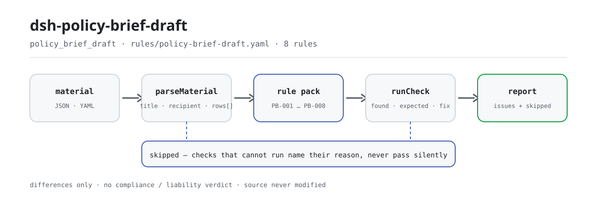

<div align="center">

<picture>
  <source media="(prefers-color-scheme: dark)" srcset="docs/assets/dsh-policy-brief-draft-flow-dark.svg">
  
</picture>

# dsh-policy-brief-draft

**Revisa un informe de política elemento por elemento —completitud y frescura de los datos— y devuelve qué fila, qué columna y qué falta, con la conclusión en manos del revisor.**

Un plugin de verificación para DeepSeek Harness, pensado para investigadores de políticas y oficinas de redacción: entra una lista de verificación de elementos del informe (la cabecera del documento más una fila por sección), y un paquete de reglas con citas literales (PB-001…PB-008) enumera solo las divergencias que el propio material permite señalar —sin tocar el original, sin peticiones de red y sin llamar a ningún modelo.

[Instalar](#instalación-en-tres-pasos) · [Configuración](#configuración) · [FAQ](#faq) · [简体中文](README.md) · [English](README.en.md) · [Español](README.es.md) · [Português](README.pt.md) · [हिन्दी](README.hi.md)

[](LICENSE)
[](#compatibilidad)
[](https://www.npmjs.com/package/dsh-policy-brief-draft)
[](https://github.com/PerryLink/dsh-policy-brief-draft/actions/workflows/ci.yml)
[](#compatibilidad)

[](https://github.com/PerryLink/dsh-policy-brief-draft/stargazers)
[](https://www.npmjs.com/package/dsh-policy-brief-draft)
[](https://dshfind.com/plugins/PerryLink/dsh-policy-brief-draft?ref=badge)
[](https://securityscorecards.dev/viewer/?uri=github.com/PerryLink/dsh-policy-brief-draft)
[](https://dsh.market/)
[](https://gitee.com/perrylink/dsh-policy-brief-draft)

```sh
dsh plugin --profile <name> add dsh-policy-brief-draft
```

</div>

<sub>Plugin de la comunidad, no afiliado a DeepSeek. Repositorio canónico: <https://github.com/PerryLink/dsh-policy-brief-draft> (Gitee es un espejo).</sub>

## Qué es

`dsh-policy-brief-draft` lee una lista de verificación de elementos de un informe de política (o de un estudio) —la cabecera del documento más una fila por sección— y comprueba la completitud y la coherencia interna de esa lista: que cada sección exponga su punto, que un punto tenga evidencia de apoyo, que la evidencia cite una fuente, que la fecha de corte de los datos se pueda analizar y no sea posterior a la fecha de revisión, que los datos caigan dentro de la ventana de frescura que usted configure, que una recomendación nombre a quien la llevaría a cabo, que la cabecera declare el título del informe y su destinatario, y que no se repita ningún número de sección. Devuelve la lista de lo que es incoherente, dónde y qué corregir; no modifica el original, no hace peticiones de red y no llama a ningún modelo. No decide si un punto es correcto, si la evidencia es suficiente, si una recomendación es viable, si los datos son fiables o si el informe debe presentarse: esos son juicios sobre la calidad de la investigación y el valor para la decisión, y quedan deliberadamente fuera de su alcance.

## Instalación en tres pasos

1. **Instalar**:

   ```sh
   dsh plugin --profile <name> add dsh-policy-brief-draft
   ```

   También puede buscar «Documents and Governance Suite» en WorkBuddy / Coze (esta comprobación es una de sus partes; disponibilidad según el catálogo).

2. **Configuración mínima** (los valores por defecto ya funcionan):

   ```yaml
   - insert:
       - id: dsh-policy-brief-draft
         name: dsh-policy-brief-draft
   ```

   Todos los parámetros ajustables viven en el esquema Schemastery de `src/config.ts` y los valores por defecto sirven tal cual; los umbrales por regla están en el paquete de reglas bajo `rules/`.

3. **Verificar que se monta**:

   ```sh
   dsh --profile <name> --dump-config | grep 'dsh-policy-brief-draft'
   ```

   Después ejecute una vez el ejemplo incluido (alrededor de un minuto):

   ```sh
   node samples/quickstart/run.mjs
   ```

   ```text
   $ node samples/quickstart/run.mjs
   policy_brief_draft: 1 issue(s) — error 1, warn 0, info 0
   skipped: 2
   ```

   La entrada de ejemplo está en `samples/quickstart/input/`, la salida esperada en `samples/quickstart/expected/result.json` y la captura de la primera ejecución en [`docs/assets/quickstart.png`](docs/assets/quickstart.png).

**Desinstalar**: `dsh plugin --profile <name> remove dsh-policy-brief-draft` (o borre la fila del profile patch).

## Capacidades clave

El plugin registra la herramienta `policy_brief_draft`: lee una lista de verificación (cabecera más una fila por sección), aplica un paquete de reglas versionado y devuelve un informe estructurado. El material es JSON o YAML; toda comprobación que no pueda ejecutarse aparece en `skipped` con su motivo.

- **El paquete de reglas es dato** — las 8 comprobaciones están en `rules/policy-brief-draft.yaml`, de modo que cambiar el conjunto de reglas no exige tocar código; el paquete se valida al cargar, no se da por bueno.
- **La gravedad sigue a la evidencia** — una regla derivada de un principio (`derived-from-principle`) tiene tope `warn`, y una cuyo umbral procede de la configuración de la institución (`institutional-configuration`) tiene tope `info`; nunca se etiqueta `error` un principio ni una configuración local (hay un test que lo asegura).
- **Una lista vacía de hallazgos no es «todo correcto»** — cada comprobación que no pueda ejecutarse se registra en `skipped` con su motivo; `PB-005` viene con `maxDays: 0`, así que se registra en `skipped` en lugar de pasar en silencio.
- **Sin adjudicar** — el informe enumera diferencias y nunca se pronuncia sobre cumplimiento, responsabilidad o corrección; un guardián de redacción obliga a que todo informe lleve el descargo.
- **Sin citas inventadas** — cada regla lleva `document` / `number` / `clause` / `excerpt` / `kind` / `source`; `excerpt` debe ser una cita literal, y cuando el texto no se tiene el paquete lo dice en lugar de presentar una paráfrasis como cita.

```text
lista del informe (JSON/YAML) ──policy_brief_draft──▶ paquete PB-001…PB-008 ──▶ informe (issues + skipped)
          ▲                                                                              │
          └───────────────────── el original es de solo lectura, nunca se modifica ─────┘
```

### Reglas de un vistazo

| Regla | Qué comprueba | Gravedad | Tipo de base |
|---|---|---|---|
| `PB-001` | cada sección expone su punto | error | artículo literal |
| `PB-002` | cada punto tiene evidencia de apoyo | warn | principio derivado |
| `PB-003` | la evidencia cita una fuente | error | artículo literal |
| `PB-004` | la fecha de corte se analiza y no está en el futuro | error | artículo literal |
| `PB-005` | los datos son suficientemente recientes según su ventana (desactivada por defecto) | info | configuración institucional |
| `PB-006` | una recomendación nombra a su responsable de ejecución | warn | principio derivado |
| `PB-007` | el informe declara su título y su destinatario | warn | artículo literal |
| `PB-008` | los números de sección son únicos en la tabla | warn | principio derivado |

### Ejemplos

Son los puntos de entrada reales del plugin; instálelo una vez y llame a uno. La salida siguiente es la ejecución real del plugin contra su propio fixture de prueba `PB-001`, no un montaje.

**Salida detallada** — herramienta `policy_brief_draft`, entrada:

```json
{"title":"某某领域投资形势分析专报","rows":[{"序号":"1","章节":"一、现状","核心观点":"","支撑依据":"全国固定资产投资统计月报（2026 年 2 月）显示本领域投资同比增长 3.1%"}]}
```

Salida:

```json
{
  "id": "dsh-policy-brief-draft.PB-001.de09b5a6",
  "ruleId": "PB-001",
  "severity": "error",
  "locator": {
    "row": 1,
    "field": "point"
  },
  "found": "第 1 行「point」为空",
  "expected": "「point」应填写",
  "fix": "补填核心观点；本条只核对是否写明，不判断观点是否成立"
}
```

*Observado en `dsh-policy-brief-draft/tests/fixtures/PB-001/PB-001-unsafe.json (cases.json expects 1×PB-001); executed parseMaterial+runCheck, checkedAt=2026-10-06T00:00:00.000Z`*

### Qué responde

| Usted pregunta | Qué responde |
|---|---|
| Una sección es todo material y ninguna conclusión: la columna del punto está vacía. | `PB-001` informa de esa sección, porque se espera que cada sección exponga su punto. Solo comprueba que la celda `point` esté rellena, así que no juzga si el punto es correcto ni si aporta algo nuevo. Es un `error`: el artículo 19(3) exige un «punto de vista claro», y ese artículo se leyó literalmente el 2026-10-13. |
| Hemos rellenado la columna de la evidencia y la de la fuente. ¿Qué verifica realmente la comprobación? | Solo que ambas celdas estén rellenas. `PB-002` exige `evidence` para cada punto y `PB-003` exige `sourceRef` junto a ella. `PB-003` es un `error`, porque el artículo 20(4) incluye la exactitud de «las citas y similares» entre los puntos de revisión previos a la emisión; `PB-002` sigue siendo un `warn`, porque ningún artículo exige una cita por punto. `PB-002` no juzga si la evidencia es suficiente, real o si sostiene el punto; `PB-003` no puede comprobar que la fuente exista ni que los datos coincidan con ella, porque el plugin lee la lista de verificación y nunca las fuentes, de modo que una cita inventada pasa. |
| La fecha de corte de los datos figura como `2026-03-15 09:30`, y una sección lleva una fecha posterior a hoy. | Se reconocen las dos formas, `2026-03-15` y `2026-03-15 09:30`. `PB-004` informa de un `dataAsOf` posterior a la fecha de revisión, es decir, o la fecha se rellenó mal o la sección cita datos que aún no existen, y un valor que no puede analizar se informa por separado en lugar de omitirse en silencio. Es un `error`: el artículo 19(2) exige que el análisis sea fáctico y el artículo 20(4) exige que la «hora» sea exacta, y una fecha de corte posterior a la fecha de revisión no puede ser cierta. No juzga si los datos son fiables. |
| La regla de frescura informa `skipped`. ¿Significa eso que los datos están bien? | No. `PB-005` viene con `maxDays: 0`, es decir, sin configurar, así que se informa a sí misma en `skipped` en lugar de inventar un número; configure `maxDays` (por ejemplo `maxDays: 90`) para activarla. Un hallazgo entonces solo significa que los datos son más antiguos que la ventana que usted fijó, nunca que sean inutilizables, y citar datos antiguos a veces es correcto, así que indique por qué en la observación. La regla es `info`: su ventana de días procede de su criterio editorial y el reglamento no fija ningún número de días. |
| Una sección formula una recomendación pero no dice quién la llevaría a cabo. | `PB-006` informa de esa sección: una vez rellenada la celda `recommendation`, se exige la celda `implementer`. Una sección que solo analiza la situación actual y no propone nada no se informa, así que la regla no molesta a las secciones de diagnóstico. Comprueba que se nombre al responsable de ejecución, no si la recomendación es viable ni si ese órgano es el adecuado. |
| ¿Qué debe declarar el propio informe, y puede repetirse el mismo número de sección? | `PB-007` exige que la cabecera declare `title` y `recipient`, y pueden añadirse otros campos de cabecera, como la clasificación o el tema, a sus `fields` si su propio formulario los recoge. `PB-008` informa de un `sectionNo` que aparece dos veces en la tabla, ignorando los espacios, porque un número repetido impide señalar un punto sin ambigüedad. `PB-007` solo comprueba que esas celdas de cabecera estén rellenas, no que el título sea acertado o el destinatario el órgano correcto, y `PB-008` compara únicamente los números. |

## Configuración

Todos los parámetros ajustables viven en el esquema Schemastery de `src/config.ts`, por lo que se cambian desde `cordis.yml` sin tocar el código; los umbrales por regla están en el paquete de reglas bajo `rules/`. Hay exactamente cinco claves de configuración, en la tabla siguiente; los parámetros por regla vienen después.

| Clave | Tipo | Predeterminado | Descripción |
|---|---|---|---|
| `rulesFile` | string | `rules/policy-brief-draft.yaml` | Ruta del paquete de reglas, relativa a la raíz del paquete |
| `disabledRules` | string[] | `[]` | Ids de reglas que se dejan de ejecutar; cada una aparece en `skipped` |
| `onlyRules` | string[] | `[]` | Ejecutar solo estas reglas; vacío ejecuta todas |
| `skipNotes` | string | `""` | Nota añadida a cada motivo de `skipped` |
| `timeoutMs` | number | `120000` | Presupuesto de tiempo de espera cooperativo de la herramienta (milisegundos) |

Parámetros por regla que conviene conocer:

- `PB-005` `maxDays` — su ventana de frescura en días. `0` significa que la regla no se ejecuta y aparece en `skipped`.
- `PB-006` `conditionField` / `requiredFields` — qué activa la exigencia del responsable de ejecución; por defecto, la columna de recomendación. Las secciones que solo analizan no lo requieren.
- `PB-007` `fields` — los campos de cabecera que deben estar presentes; por defecto, título y destinatario. Añada `classification` si sus informes llevan marca de seguridad.

## FAQ

<details>
<summary>¿Se modificará o se subirá mi material?</summary>

No. La herramienta solo lee el texto JSON/YAML que usted le entrega y **nunca modifica el archivo original**; el plugin es ESM puro, no tiene código nativo, **no hace peticiones de red y no llama a ningún modelo** (véase «Compatibilidad»), así que el material no sale de su máquina.

</details>

<details>
<summary>Sin ventana de frescura configurada, ¿pasará en silencio?</summary>

No. `PB-005` viene con `maxDays` sin definir (`0`), así que la regla se registra en `skipped` con su motivo: una lista vacía de hallazgos no puede leerse como «no falta nada». Configure `maxDays` y empezará a ejecutarse; después, un hallazgo significa que los datos son más antiguos que la ventana que fijó, nunca que sean inutilizables.

</details>

<details>
<summary>El plugin se instala pero la herramienta no aparece. ¿Qué hago?</summary>

Compruebe que `main` apunta a `lib/index.mjs` y que `pnpm run build` lo generó; un `main` incorrecto hace que el cargador omita la entrada en silencio.

</details>

<details>
<summary>La instalación se rechaza por incompatibilidad. ¿Qué hago?</summary>

El rango de peers cubre `0.1.x` y `0.2.x`; si su runtime queda fuera, conceda una exención explícita: `dsh plugin --profile <name> allow-version dsh-policy-brief-draft@0.1.0 --dsh-version <runtime> --accept-risk`. El runtime aplica la compatibilidad de peers al instalar.

</details>

<details>
<summary>¿Puede manejar un informe completo, o un directorio entero, en una sola ejecución?</summary>

La herramienta funciona en modo `native` y `ptc`; para un conjunto grande de documentos prefiera `ptc`, así el coste del esquema se paga una vez. Toda la aritmética es de hora local sobre las cadenas entregadas, sin conversión de zona horaria.

</details>

## Normas que sigue

| Documento | Número | Reglas que lo citan |
|---|---|---|
| Reglamento sobre el tratamiento de documentos oficiales de los órganos del Partido y del Gobierno | Zhongbanfa [2012] n.º 14 (texto completo obtenido; la cláusula literal ya está incorporada en el `excerpt` de cada regla) | PB-001, PB-002, PB-003, PB-004, PB-005, PB-006, PB-007, PB-008 |

**Límite:** este plugin comprueba una **lista de verificación de elementos de un informe de política** por lo que esa lista puede exigir de forma mecánica: que cada sección exponga su punto, que un punto tenga evidencia de apoyo, que la evidencia cite una fuente, que la fecha de corte se analice y no esté en el futuro, que los datos sean suficientemente recientes según su ventana, que una recomendación nombre a quien la ejecutaría, que el informe nombre su título y destinatario, y que los números de sección sean únicos. **No** decide si un punto es correcto, si la evidencia es suficiente, si una recomendación es viable, si los datos son fiables o si el informe debe presentarse. **Son juicios sobre la calidad de la investigación y el valor para la decisión.**

> ### ⚠️ Lo que este plugin puede y no puede ver
>
> **Lee una lista de verificación, no las fuentes ni los datos.** Por eso solo puede comprobar que una fuente esté *citada* —nunca que exista ni que los datos coincidan con ella. `PB-003` lo dice en su propia nota, y la sección de solución de problemas de este README lo repite: una cita inventada pasará, porque verificar fuentes es otro trabajo.
>
> **El reglamento (Zhongbanfa [2012] n.º 14) se obtuvo y se leyó literalmente**, y `rules/evidence/clause-verification.md` registra qué artículos se citaron: el artículo 8(10) (el informe sirve para informar a un órgano superior), el artículo 19 (redacción: «el análisis debe ser fáctico», «las políticas y medidas propuestas deben ser viables», «el punto de vista debe ser claro») y el artículo 20(4), que incluye la exactitud de «las citas y similares» entre los puntos de revisión previos a la emisión.
>
> **El texto de los artículos ya está en el paquete y las gravedades se volvieron a derivar de él (2026-10-13).** El reglamento regula cómo se *redacta y se emite* un documento; este plugin comprueba si el *esquema* de un informe registra sus puntos, evidencia, fuentes y recomendaciones. Son dos cosas distintas, así que la regla se aplicó artículo por artículo y no en bloque:
>
> - **Elevadas a `error`** donde un artículo enuncia el requisito que busca la comprobación: `PB-001` (19(3), punto de vista claro), `PB-003` (20(4) incluye la exactitud de las citas como punto de revisión previo a la emisión) y `PB-004` (19(2), análisis fáctico, con 20(4), hora exacta: una fecha de corte posterior a la fecha de revisión no puede ser cierta).
> - **Se mantienen en `warn` aunque el texto se haya obtenido**, porque el artículo trata de otra cosa: `PB-002` (ningún artículo exige una cita por punto), `PB-006` (ninguno exige nombrar un responsable de ejecución), `PB-008` (ninguno exige números de sección únicos) y **`PB-007`**, cuyo artículo 9 regula los dieciocho elementos de formato de un documento formal y no dos columnas de un esquema de trabajo: llamar `direct` a una celda de cabecera vacía como incumplimiento del artículo 9 sería disfrazar una laguna del registro de incumplimiento normativo.
> - **Siguen en `info`**: `PB-005`, cuya ventana es su criterio editorial y no figura en el reglamento.
>
> Así pues, **3 reglas son `error`, 4 son `warn` y 1 es `info`**: la división es el punto, no una transacción: obtener un texto solo autoriza una cita `direct` cuando el texto dice realmente lo que se comprueba. Véase `rules/evidence/clause-verification-gongwen-tiaoli-direct.md`, que también registra en qué discrepa del análisis anterior de `clause-verification.md`.
>
> **La ventana de frescura de los datos viene sin definir.** Cuán antiguo es demasiado antiguo es su criterio editorial —un informe rápido puede exigir las cifras del mes pasado mientras un análisis anual cita legítimamente los datos del año—, así que el `maxDays` de `PB-005` parte de `0` y la regla se registra en `skipped` en lugar de inventar un número. Un hallazgo ahí significa «más antiguo que la ventana que usted fijó», nunca «inutilizable»; citar datos más antiguos a veces es correcto, y la solución es explicar por qué en la observación.

## Formato del material

La herramienta acepta JSON o YAML:

```yaml
title: 某某领域投资形势分析专报
topic: 投资形势
recipient: 某某部门
draftedAt: 2026-03-12
classification: 内部
rows:
  - { 序号: '1', 章节: 一、现状,
      核心观点: 本领域投资增速连续三个季度回落，结构性分化明显,
      支撑依据: 全国固定资产投资统计月报（2026 年 2 月）显示本领域投资同比增长 3.1%,
      出处: 国家统计局月度数据，2026 年 3 月发布, 数据截止日期: 2026-02-28,
      风险提示: 月度数据存在季节因素，需结合同比口径判断 }
```

Los nombres de columna se comparan sin distinguir mayúsculas y minúsculas y sin tener en cuenta espacios, guiones bajos y guiones; se conservan los nombres de columna de la lista, de modo que un hallazgo nombra la columna que leyó. Las fechas pueden ser `2026-02-28` o `2026-02-28 09:30`. Los campos son opcionales en la capa de lectura y los valida el motor de comprobación, así que una exportación parcial produce hallazgos sobre lo que falta en lugar de un fallo.

## Fuentes de las reglas

Los datos de las reglas están en `rules/policy-brief-draft.yaml`, separados del código. Cada regla lleva el documento, su número, la cláusula en la numeración propia de la fuente, un `excerpt` literal, una URL de origen y un tipo de base (`kind`). El cargador impone que un `excerpt` sea una cita real de al menos ocho caracteres, y que una comprobación basada solo en un principio derivado (`derived-from-principle`, gravedad con tope `warn`) o en la configuración institucional (`institutional-configuration`, tope `info`) nunca se etiquete `error`. Un paquete que exagera su base falla al cargar en lugar de producir un informe de aspecto seguro.

Los artículos citados proceden del Reglamento sobre el tratamiento de documentos oficiales de los órganos del Partido y del Gobierno (Zhongbanfa [2012] n.º 14): artículo 8(10), artículo 9 (incluidos (7) título y (8) destinatario principal), artículo 19(2)(3) y artículo 20(4). Los límites confirmados durante la verificación y las conclusiones deliberadamente no extraídas están en `rules/evidence/`, en particular `clause-verification-gongwen-tiaoli-direct.md` y `clause-verification.md`.

## Compatibilidad

| Superficie | Estado |
|---|---|
| Harness | Rango de peers `>=0.1.2-rc.1 <0.2.0 \|\| >=0.2.0-0 <0.3.0` — verificado para aceptar tanto `0.2.0-rc.2` como `0.2.1-rc.2`. `engines.dsh` se declara como `>=0.2.1-0 <0.3.0` y el host lo aplica desde 0.2.1 |
| Node | `^22.19.0 \|\| >=24.0.0` |
| Plataformas | Todas (ESM puro; sin código nativo, sin red, sin llamada al modelo) |
| Modo de herramienta | Funciona en `native` y `ptc`; para una lista larga use `ptc` |

## Solución de problemas

- **`PB-005` nunca se ejecuta.** La ventana de frescura está vacía (`maxDays: 0`). Cuán antiguo es demasiado antiguo es su criterio editorial y el plugin no lo inventa; configure `maxDays` (por ejemplo `90`) para activarla.
- **`PB-003` acepta una fuente que sé que es inventada.** No puede comprobarlo: verifica que una fuente esté *citada*, no que exista o diga lo que el informe afirma.
- **`PB-005` salta con datos que cité deliberadamente.** Los datos antiguos a veces son los correctos. Amplíe `maxDays` o registre el motivo en la observación: el hallazgo es sobre la ventana, no sobre los datos.
- **`PB-006` no salta en una sección de análisis.** Es deliberado: el responsable de ejecución solo se exige cuando se formula realmente una recomendación.
- **`PB-004` salta con una fecha futura.** O la fecha de corte o la de redacción está mal; un informe no puede apoyarse en cifras que aún no existen.
- **El plugin se instala pero la herramienta no aparece.** Compruebe que `main` resuelve a `lib/index.mjs` y que `pnpm run build` lo generó; un `main` incorrecto hace que el cargador omita la entrada en silencio.
- **`dsh plugin add` rechaza el paquete por incompatibilidad.** El rango de peers cubre `0.1.x` y `0.2.x`; si su runtime queda fuera, conceda una exención explícita: `dsh plugin --profile <name> allow-version dsh-policy-brief-draft@0.1.0 --dsh-version <runtime> --accept-risk`
- **Una regla no se ejecutó.** Lea el arreglo `skipped`; indica el id de la regla y el motivo.
- **`check` informa `manifest-peers` como fallo.** El verificador estático compara con un rango de peers codificado que es anterior a la línea 0.2. El runtime aplica la compatibilidad de peers al instalar, así que el rango declarado es el correcto; es un problema conocido de `dsh-plugin-dev`.
- **Los horarios parecen desplazados.** Toda la aritmética es de hora local sobre las cadenas de entrada, sin conversión de zona horaria.

## Ecosistema y calidad

- [Espejo en Gitee](https://gitee.com/perrylink/dsh-policy-brief-draft) (espejo sincronizado; GitHub es canónico)
- [Página del plugin en dshfind](https://dshfind.com/plugins/PerryLink/dsh-policy-brief-draft) (instalaciones y ranking)
- [Informe OpenSSF Scorecard](https://securityscorecards.dev/viewer/?uri=github.com/PerryLink/dsh-policy-brief-draft) (impulsado por [.github/workflows/scorecard.yml](.github/workflows/scorecard.yml))
- [DSH Market](https://dsh.market/) (en el catálogo)
- [Base de conocimiento del ecosistema · elegir un verificador por material](https://perrylink.github.io/zh/checkers/choose/) (índice completo de la familia: verificadores + plugins generales)

## Desarrollo

```sh
pnpm install
pnpm run typecheck   # tsc --noEmit
pnpm test            # vitest; cada regla tiene fixtures conforme/violador emparejados en tests/fixtures/<RULE>/
pnpm run build       # tsdown -> lib/index.mjs + lib/index.d.mts
pnpm run check:readmes   # coherencia de los README en cinco idiomas
node ../scripts/sync-shared.mjs dsh-policy-brief-draft   # refrescar src/shared desde ../_shared
```

El plugin es solo datos: `src/model.ts` declara la forma de la tabla, el kit compartido aporta el lector y el motor de comprobación, y el paquete de reglas declara cada comprobación. El paquete de reglas es dato, no código: sustituir `rules/*.yaml` cambia el conjunto de reglas sin tocar TypeScript, y el paquete se valida al cargar en lugar de darse por bueno. Las imágenes del README las genera por programa [`scripts/gen-readme-assets.py`](scripts/gen-readme-assets.py) (Python + Pillow) y se pueden volver a ejecutar; este plugin no tiene UI, así que el hero es un diagrama de flujo SVG escrito a mano (claro y oscuro, solo tokens de la superficie de comandos).

Topics: `dsh`, `dsh-plugin`, `deepseek-harness`, `cordis`, `policy`, `brief`, `draft`

## Familia y agradecimientos

Este proyecto forma parte de la familia de plugins de DeepSeek Harness mantenida por [PerryLink](https://github.com/PerryLink) (todos Apache-2.0). Si le resulta útil, **una estrella ayuda a que la siguiente persona lo encuentre** — no desbloquea ninguna función.

- [@PerryLink](https://github.com/PerryLink) — creador y mantenedor: la herramienta `policy_brief_draft`, el paquete de reglas con citas literales y su registro de verificación de cláusulas, y la documentación en cinco idiomas.

<details>
<summary>Expandir todos los plugins</summary>

| Plugin | Estado |
|---|---|
| **[dsh-aqua-input-check](https://github.com/PerryLink/dsh-aqua-input-check)** |  |
| **[dsh-archive-check](https://github.com/PerryLink/dsh-archive-check)** |  |
| **[dsh-auto-review](https://github.com/PerryLink/dsh-auto-review)** |  |
| **[dsh-autotier](https://github.com/PerryLink/dsh-autotier)** | 🧊 CONGELADO — ver el README del repo |
| **[dsh-bid-ca-precheck](https://github.com/PerryLink/dsh-bid-ca-precheck)** |  |
| **[dsh-bid-qual-check](https://github.com/PerryLink/dsh-bid-qual-check)** |  |
| **[dsh-cert-mcp](https://github.com/PerryLink/dsh-cert-mcp)** | 🧊 CONGELADO — ver el README del repo |
| **[dsh-checkpoint-rewind](https://github.com/PerryLink/dsh-checkpoint-rewind)** |  |
| **[dsh-click](https://github.com/PerryLink/dsh-click)** |  |
| **[dsh-composer-history](https://github.com/PerryLink/dsh-composer-history)** |  |
| **[dsh-contract-stance](https://github.com/PerryLink/dsh-contract-stance)** |  |
| **[dsh-customs-doc-check](https://github.com/PerryLink/dsh-customs-doc-check)** |  |
| **[dsh-data-quality](https://github.com/PerryLink/dsh-data-quality)** | 🧊 CONGELADO — ver el README del repo |
| **[dsh-demurrage-ledger](https://github.com/PerryLink/dsh-demurrage-ledger)** |  |
| **[dsh-doublecheck](https://github.com/PerryLink/dsh-doublecheck)** |  |
| **[dsh-drill-script-check](https://github.com/PerryLink/dsh-drill-script-check)** |  |
| **[dsh-eia-guide-check](https://github.com/PerryLink/dsh-eia-guide-check)** |  |
| **[dsh-emergency-plan](https://github.com/PerryLink/dsh-emergency-plan)** |  |
| **[dsh-essay-rubric-check](https://github.com/PerryLink/dsh-essay-rubric-check)** |  |
| **[dsh-evidence-check](https://github.com/PerryLink/dsh-evidence-check)** |  |
| **[dsh-export-ctl-check](https://github.com/PerryLink/dsh-export-ctl-check)** |  |
| **[dsh-fast](https://github.com/PerryLink/dsh-fast)** |  |
| **[dsh-fmea-table-check](https://github.com/PerryLink/dsh-fmea-table-check)** |  |
| **[dsh-forecast-penalty](https://github.com/PerryLink/dsh-forecast-penalty)** |  |
| **[dsh-fund-research](https://github.com/PerryLink/dsh-fund-research)** |  |
| **[dsh-github](https://github.com/PerryLink/dsh-github)** |  |
| **[dsh-gongwen-flow-check](https://github.com/PerryLink/dsh-gongwen-flow-check)** |  |
| **[dsh-gongwen-word-check](https://github.com/PerryLink/dsh-gongwen-word-check)** |  |
| **[dsh-guard-plan-qc](https://github.com/PerryLink/dsh-guard-plan-qc)** |  |
| **[dsh-hazchem-check](https://github.com/PerryLink/dsh-hazchem-check)** |  |
| **[dsh-hazplan-check](https://github.com/PerryLink/dsh-hazplan-check)** |  |
| **[dsh-hidden-risk-map](https://github.com/PerryLink/dsh-hidden-risk-map)** |  |
| **[dsh-hs-classify](https://github.com/PerryLink/dsh-hs-classify)** |  |
| **[dsh-icd-rule-check](https://github.com/PerryLink/dsh-icd-rule-check)** |  |
| **[dsh-industry-research](https://github.com/PerryLink/dsh-industry-research)** |  |
| **[dsh-lawcite-adapter](https://github.com/PerryLink/dsh-lawcite-adapter)** |  |
| **[dsh-laya](https://github.com/PerryLink/dsh-laya)** |  |
| **[dsh-lc-doc-check](https://github.com/PerryLink/dsh-lc-doc-check)** |  |
| **[dsh-learning-gap-check](https://github.com/PerryLink/dsh-learning-gap-check)** |  |
| **[dsh-library](https://github.com/PerryLink/dsh-library)** |  |
| **[dsh-local-ai](https://github.com/PerryLink/dsh-local-ai)** |  |
| **[dsh-lsp-actions](https://github.com/PerryLink/dsh-lsp-actions)** |  |
| **[dsh-mask](https://github.com/PerryLink/dsh-mask)** |  |
| **[dsh-mcp-panel](https://github.com/PerryLink/dsh-mcp-panel)** |  |
| **[dsh-medrec-qc](https://github.com/PerryLink/dsh-medrec-qc)** |  |
| **[dsh-memento](https://github.com/PerryLink/dsh-memento)** |  |
| **[dsh-nsfc-form-check](https://github.com/PerryLink/dsh-nsfc-form-check)** |  |
| **[dsh-nurse-record-check](https://github.com/PerryLink/dsh-nurse-record-check)** |  |
| **[dsh-observe](https://github.com/PerryLink/dsh-observe)** |  |
| **[dsh-origin-rvc-check](https://github.com/PerryLink/dsh-origin-rvc-check)** |  |
| **[dsh-ota-review-check](https://github.com/PerryLink/dsh-ota-review-check)** |  |
| **[dsh-output-styles](https://github.com/PerryLink/dsh-output-styles)** |  |
| **[dsh-paper-doc-adapter](https://github.com/PerryLink/dsh-paper-doc-adapter)** |  |
| **[dsh-permission-rules](https://github.com/PerryLink/dsh-permission-rules)** |  |
| **[dsh-permit-report-check](https://github.com/PerryLink/dsh-permit-report-check)** |  |
| **[dsh-pipeline-check](https://github.com/PerryLink/dsh-pipeline-check)** |  |
| **[dsh-pleading-draft](https://github.com/PerryLink/dsh-pleading-draft)** |  |
| **[dsh-plugin-doctor](https://github.com/PerryLink/dsh-plugin-doctor)** | 🚫 RETIRADO (repo archivado) |
| **[dsh-plugin-guide](https://github.com/PerryLink/dsh-plugin-guide)** |  |
| **[dsh-plugin-kit](https://github.com/PerryLink/dsh-plugin-kit)** | 🚫 RETIRADO (repo archivado) |
| **[dsh-plugin-upgrade](https://github.com/PerryLink/dsh-plugin-upgrade)** | 🚫 RETIRADO (repo archivado) |
| **[dsh-policy-brief-draft](https://github.com/PerryLink/dsh-policy-brief-draft)** |  |
| **[dsh-power-loss-split](https://github.com/PerryLink/dsh-power-loss-split)** |  |
| **[dsh-power-ticket-check](https://github.com/PerryLink/dsh-power-ticket-check)** |  |
| **[dsh-ppap-check](https://github.com/PerryLink/dsh-ppap-check)** |  |
| **[dsh-protest-deadline](https://github.com/PerryLink/dsh-protest-deadline)** |  |
| **[dsh-railway-window](https://github.com/PerryLink/dsh-railway-window)** |  |
| **[dsh-repair-order-qc](https://github.com/PerryLink/dsh-repair-order-qc)** |  |
| **[dsh-research-report](https://github.com/PerryLink/dsh-research-report)** |  |
| **[dsh-review-reply-check](https://github.com/PerryLink/dsh-review-reply-check)** |  |
| **[dsh-rulefile-check](https://github.com/PerryLink/dsh-rulefile-check)** |  |
| **[dsh-safety-brief-check](https://github.com/PerryLink/dsh-safety-brief-check)** |  |
| **[dsh-score](https://github.com/PerryLink/dsh-score)** | 🧊 CONGELADO — ver el README del repo |
| **[dsh-session-sync](https://github.com/PerryLink/dsh-session-sync)** |  |
| **[dsh-site-log-check](https://github.com/PerryLink/dsh-site-log-check)** |  |
| **[dsh-skill-pack-security](https://github.com/PerryLink/dsh-skill-pack-security)** |  |
| **[dsh-soe-decision-check](https://github.com/PerryLink/dsh-soe-decision-check)** |  |
| **[dsh-soilwater-check](https://github.com/PerryLink/dsh-soilwater-check)** |  |
| **[dsh-sop-sync-check](https://github.com/PerryLink/dsh-sop-sync-check)** |  |
| **[dsh-spc-gbt-adapter](https://github.com/PerryLink/dsh-spc-gbt-adapter)** |  |
| **[dsh-talk](https://github.com/PerryLink/dsh-talk)** |  |
| **[dsh-tender-extract](https://github.com/PerryLink/dsh-tender-extract)** |  |
| **[dsh-tender-matrix](https://github.com/PerryLink/dsh-tender-matrix)** |  |
| **[dsh-test-drive](https://github.com/PerryLink/dsh-test-drive)** |  |
| **[dsh-ticktick](https://github.com/PerryLink/dsh-ticktick)** | 🚫 RETIRADO (repo archivado) |
| **[dsh-translate](https://github.com/PerryLink/dsh-translate)** |  |
| **[dsh-warranty-calc](https://github.com/PerryLink/dsh-warranty-calc)** |  |
| **[dsh-budget](https://github.com/PerryLink/dsh-budget)** | 🧊 CONGELADO — ver el README del repo |
| **[dsh-claude-move](https://github.com/PerryLink/dsh-claude-move)** | 🧊 CONGELADO — ver el README del repo |
| **[dsh-defend](https://github.com/PerryLink/dsh-defend)** | 🧊 CONGELADO — ver el README del repo |
| **[dsh-draw](https://github.com/PerryLink/dsh-draw)** | 🧊 CONGELADO — ver el README del repo |
| **[dsh-reach](https://github.com/PerryLink/dsh-reach)** | 🧊 CONGELADO — ver el README del repo |
| **[dsh-background-agents](https://github.com/PerryLink/dsh-background-agents)** | 🚫 RETIRADO (repo archivado) |
| **[dsh-session-pin](https://github.com/PerryLink/dsh-session-pin)** | 🚫 RETIRADO (repo archivado) |
| **[dsh-team-rooms](https://github.com/PerryLink/dsh-team-rooms)** | 🚫 RETIRADO (repo archivado) |

</details>

## Licencia

[LICENSE](LICENSE) (Apache License 2.0) © 2026 dsh-policy-brief-draft contributors

<p align="center"><sub>Apache-2.0 · Plugin de la comunidad, no afiliado a DeepSeek.</sub></p>
