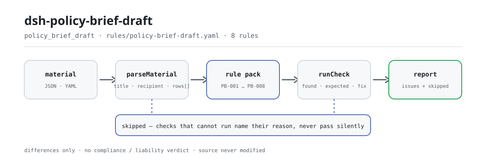

<div align="center">

<picture>
  <source media="(prefers-color-scheme: dark)" srcset="docs/assets/dsh-policy-brief-draft-flow-dark.svg">
  
</picture>

# dsh-policy-brief-draft

**नीति ब्रीफ़ के तत्वों की पूर्णता और डेटा-ताज़गी की जाँच खंड-दर-खंड करें — और पाएँ कौन-सी पंक्ति, कौन-सा कॉलम, क्या कम है; निर्णय समीक्षक के हाथ में रहता है।**

नीति-शोधकर्ताओं और लेखन-प्रकोष्ठों के लिए DeepSeek Harness जाँच प्लगइन: नीति ब्रीफ़ की तत्व-चेकलिस्ट (दस्तावेज़ का हेडर और प्रत्येक खंड की एक पंक्ति) भीतर जाती है, और शब्दशः उद्धरण वाला नियम-पैक (PB-001…PB-008) केवल वही अंतर गिनाता है जो सामग्री स्वयं बता सकती है — मूल फ़ाइल को छुए बिना, कोई नेटवर्क अनुरोध किए बिना और किसी मॉडल को बुलाए बिना।

[इंस्टॉल](#तीन-चरणों-में-शुरुआत) · [कॉन्फ़िगरेशन](#कॉन्फ़िगरेशन) · [FAQ](#faq) · [简体中文](README.md) · [English](README.en.md) · [Español](README.es.md) · [Português](README.pt.md) · [हिन्दी](README.hi.md)

[](LICENSE)
[](#संगतता)
[](https://www.npmjs.com/package/dsh-policy-brief-draft)
[](https://github.com/PerryLink/dsh-policy-brief-draft/actions/workflows/ci.yml)
[](#संगतता)

[](https://github.com/PerryLink/dsh-policy-brief-draft/stargazers)
[](https://www.npmjs.com/package/dsh-policy-brief-draft)
[](https://dshfind.com/plugins/PerryLink/dsh-policy-brief-draft?ref=badge)
[](https://securityscorecards.dev/viewer/?uri=github.com/PerryLink/dsh-policy-brief-draft)
[](https://dsh.market/)
[](https://gitee.com/perrylink/dsh-policy-brief-draft)

```sh
dsh plugin --profile <name> add dsh-policy-brief-draft
```

</div>

<sub>समुदाय प्लगइन, DeepSeek से संबद्ध नहीं। आधिकारिक रेपो: <https://github.com/PerryLink/dsh-policy-brief-draft> (Gitee एक मिरर है)।</sub>

## यह क्या है

`dsh-policy-brief-draft` नीति ब्रीफ़ (या शोध-प्रतिवेदन) की तत्व-चेकलिस्ट पढ़ता है — दस्तावेज़ का हेडर और प्रत्येक खंड की एक पंक्ति — और उसी चेकलिस्ट की पूर्णता तथा आंतरिक संगति जाँचता है: क्या हर खंड अपना मुख्य बिंदु लिखता है, क्या बिंदु के पास आधार है, क्या आधार में स्रोत दर्ज है, क्या डेटा की अंतिम तिथि पढ़ी जा सकती है और जाँच की तिथि से बाद की नहीं है, क्या आँकड़े आपकी तय की गई ताज़गी विंडो के भीतर हैं, क्या सिफ़ारिश में लिखा है कि उसे कौन लागू करेगा, क्या हेडर ब्रीफ़ का शीर्षक और प्राप्तकर्ता घोषित करता है, और क्या कोई खंड संख्या दोहराई नहीं गई है। यह बताता है कि क्या असंगत है, कहाँ है और क्या सुधारना है; मूल फ़ाइल कभी नहीं बदलता, कोई नेटवर्क अनुरोध नहीं करता और किसी मॉडल को नहीं बुलाता। यह तय नहीं करता कि बिंदु सही है, आधार पर्याप्त है, सिफ़ारिश व्यावहारिक है, डेटा भरोसेमंद है या ब्रीफ़ भेजा जाना चाहिए — वे शोध-गुणवत्ता और निर्णय-मूल्य के निर्णय हैं, और जानबूझकर इसके दायरे से बाहर हैं।

## तीन चरणों में शुरुआत

1. **इंस्टॉल करें**:

   ```sh
   dsh plugin --profile <name> add dsh-policy-brief-draft
   ```

   WorkBuddy / Coze में "Documents and Governance Suite" भी खोज सकते हैं (यह जाँच उसका एक हिस्सा है; उपलब्धता सूची के अनुसार)।

2. **न्यूनतम कॉन्फ़िगरेशन** (डिफ़ॉल्ट वैसे ही काम करते हैं):

   ```yaml
   - insert:
       - id: dsh-policy-brief-draft
         name: dsh-policy-brief-draft
   ```

   सभी समायोज्य पैरामीटर `src/config.ts` के Schemastery स्कीमा में हैं और डिफ़ॉल्ट जैसे हैं वैसे ही उपयोगी हैं; प्रति-नियम सीमाएँ `rules/` के नियम-पैक में हैं।

3. **जाँचें कि यह माउंट होता है**:

   ```sh
   dsh --profile <name> --dump-config | grep 'dsh-policy-brief-draft'
   ```

   फिर साथ दिया नमूना एक बार चलाएँ (लगभग एक मिनट):

   ```sh
   node samples/quickstart/run.mjs
   ```

   ```text
   $ node samples/quickstart/run.mjs
   policy_brief_draft: 1 issue(s) — error 1, warn 0, info 0
   skipped: 2
   ```

   नमूना इनपुट `samples/quickstart/input/` में, अपेक्षित आउटपुट `samples/quickstart/expected/result.json` में, और पहली बार चलाने का टर्मिनल स्क्रीनशॉट [`docs/assets/quickstart.png`](docs/assets/quickstart.png) में है।

**अनइंस्टॉल**: `dsh plugin --profile <name> remove dsh-policy-brief-draft` (या profile patch से वह पंक्ति हटा दें)।

## मुख्य क्षमताएँ

प्लगइन `policy_brief_draft` टूल पंजीकृत करता है: यह एक तत्व-चेकलिस्ट (हेडर और प्रत्येक खंड की एक पंक्ति) पढ़ता है, संस्करण-युक्त नियम-पैक लागू करता है और एक संरचित रिपोर्ट लौटाता है। सामग्री JSON या YAML है; जो जाँच नहीं चल सकती वह `skipped` में कारण के साथ दर्ज होती है।

- **नियम-पैक डेटा है** — सभी 8 जाँचें `rules/policy-brief-draft.yaml` में हैं, इसलिए नियम-समुच्चय बदलने के लिए कोड बदलने की ज़रूरत नहीं; पैक लोड के समय सत्यापित होता है, मान लिया नहीं जाता।
- **गंभीरता आधार के अनुसार** — सिद्धांत से व्युत्पन्न नियम (`derived-from-principle`) की अधिकतम सीमा `warn` है, और जिसकी सीमा संस्था के कॉन्फ़िगरेशन से आती है (`institutional-configuration`) उसकी अधिकतम सीमा `info` है; किसी सिद्धांत या स्थानीय कॉन्फ़िगरेशन को कभी `error` नहीं कहा जाता (एक टेस्ट इसे सुनिश्चित करता है)।
- **खाली अंतर-सूची का अर्थ "सब ठीक" नहीं** — जो जाँच नहीं चल सकती वह अपना कारण `skipped` में दर्ज करती है; `PB-005` `maxDays: 0` के साथ आता है, इसलिए वह चुपचाप पास होने के बजाय स्वयं को `skipped` में दर्ज करता है।
- **कोई निर्णय नहीं** — रिपोर्ट केवल अंतर गिनाती है और अनुपालन, उत्तरदायित्व या सत्यता पर कभी फ़ैसला नहीं देती; एक शब्द-संरक्षक हर रिपोर्ट पर अस्वीकरण अनिवार्य करता है।
- **कोई गढ़ा हुआ उद्धरण नहीं** — हर नियम `document` / `number` / `clause` / `excerpt` / `kind` / `source` रखता है; `excerpt` शब्दशः उद्धरण होना चाहिए, और जब पाठ उपलब्ध न हो तो पैक यह कह देता है, किसी विवरण को उद्धरण बताकर पेश नहीं करता।

```text
ब्रीफ़ चेकलिस्ट (JSON/YAML) ──policy_brief_draft──▶ नियम-पैक PB-001…PB-008 ──▶ रिपोर्ट (issues + skipped)
          ▲                                                                              │
          └───────────────────── मूल फ़ाइल केवल पढ़ने के लिए, कभी नहीं बदलती ───────────┘
```

### नियम एक नज़र में

| नियम | क्या जाँचता है | गंभीरता | आधार-प्रकार |
|---|---|---|---|
| `PB-001` | प्रत्येक खंड अपना मुख्य बिंदु लिखता है | error | शब्दशः अनुच्छेद |
| `PB-002` | प्रत्येक बिंदु के पास आधार है | warn | व्युत्पन्न सिद्धांत |
| `PB-003` | आधार में स्रोत दर्ज है | error | शब्दशः अनुच्छेद |
| `PB-004` | डेटा की अंतिम तिथि पढ़ी जा सकती है और भविष्य की नहीं है | error | शब्दशः अनुच्छेद |
| `PB-005` | आपकी विंडो के अनुसार डेटा पर्याप्त ताज़ा है (डिफ़ॉल्ट रूप से बंद) | info | संस्थागत कॉन्फ़िगरेशन |
| `PB-006` | सिफ़ारिश अपने कार्यान्वयनकर्ता का नाम देती है | warn | व्युत्पन्न सिद्धांत |
| `PB-007` | ब्रीफ़ अपना शीर्षक और प्राप्तकर्ता घोषित करती है | warn | शब्दशः अनुच्छेद |
| `PB-008` | तालिका में खंड संख्याएँ अद्वितीय हैं | warn | व्युत्पन्न सिद्धांत |

### उदाहरण

ये प्लगइन के वास्तविक प्रवेश-बिंदु हैं; एक बार इंस्टॉल करें, फिर किसी एक को कॉल करें। नीचे दिया आउटपुट प्लगइन के अपने `PB-001` टेस्ट फ़िक्स्चर पर वास्तविक रन है, कोई नकली चित्र नहीं।

**विस्तृत आउटपुट** — टूल `policy_brief_draft`, इनपुट:

```json
{"title":"某某领域投资形势分析专报","rows":[{"序号":"1","章节":"一、现状","核心观点":"","支撑依据":"全国固定资产投资统计月报（2026 年 2 月）显示本领域投资同比增长 3.1%"}]}
```

आउटपुट:

```json
{
  "id": "dsh-policy-brief-draft.PB-001.de09b5a6",
  "ruleId": "PB-001",
  "severity": "error",
  "locator": {
    "row": 1,
    "field": "point"
  },
  "found": "第 1 行「point」为空",
  "expected": "「point」应填写",
  "fix": "补填核心观点；本条只核对是否写明，不判断观点是否成立"
}
```

*स्रोत `dsh-policy-brief-draft/tests/fixtures/PB-001/PB-001-unsafe.json (cases.json expects 1×PB-001); executed parseMaterial+runCheck, checkedAt=2026-10-06T00:00:00.000Z`*

### यह किन सवालों का जवाब देता है

| आपका सवाल | इसका जवाब |
|---|---|
| एक खंड में केवल सामग्री है, कोई निष्कर्ष नहीं — मुख्य बिंदु का कॉलम खाली है। | `PB-001` उस खंड को दर्ज करता है, क्योंकि प्रत्येक खंड में अपना मुख्य बिंदु लिखा होना अपेक्षित है। यह केवल देखता है कि `point` सेल भरा है, इसलिए यह नहीं आँकता कि बिंदु सही है या उसमें कुछ नया है। यह `error` है: अनुच्छेद 19(3) "स्पष्ट दृष्टिकोण" की अपेक्षा करता है, और वह अनुच्छेद 2026-10-13 को शब्दशः पढ़ा गया। |
| हमने आधार और स्रोत, दोनों कॉलम भर दिए हैं — जाँच असल में क्या जाँचती है? | केवल यह कि दोनों सेल भरे हैं। `PB-002` हर बिंदु के लिए `evidence` की अपेक्षा करता है और `PB-003` उसके साथ `sourceRef` की। `PB-003` `error` है, क्योंकि अनुच्छेद 20(4) जारी करने से पहले की समीक्षा में "उद्धरण आदि की सटीकता" को शामिल करता है; `PB-002` `warn` ही रहता है, क्योंकि कोई अनुच्छेद हर बिंदु के लिए एक उद्धरण की अपेक्षा नहीं करता। `PB-002` यह नहीं आँकता कि आधार पर्याप्त है, सच है या उस बिंदु का समर्थन करता है; `PB-003` यह नहीं देख सकता कि स्रोत मौजूद है या आँकड़े उससे मेल खाते हैं, क्योंकि प्लगिन चेकलिस्ट पढ़ता है और स्रोत कभी नहीं, इसलिए गढ़ा हुआ स्रोत भी पास हो जाता है। |
| डेटा की अंतिम तिथि `2026-03-15 09:30` लिखी है, और एक खंड में आज के बाद की तिथि है। | `2026-03-15` और `2026-03-15 09:30`, दोनों रूप पढ़े जाते हैं। `PB-004` जाँच की तिथि के बाद की `dataAsOf` दर्ज करता है, यानी या तो तिथि गलत भरी गई है या खंड ऐसे आँकड़ों का हवाला दे रहा है जो अभी बने ही नहीं, और जो मान पढ़ा न जा सके वह अलग से दर्ज होता है, चुपचाप छोड़ा नहीं जाता। यह `error` है: अनुच्छेद 19(2) तथ्य-आधारित विश्लेषण की और अनुच्छेद 20(4) "समय" की सटीकता की अपेक्षा करता है, और समीक्षा-तिथि के बाद की कट-off तिथि सच नहीं हो सकती। आँकड़े भरोसेमंद हैं या नहीं, यह नहीं आँकता। |
| ताज़गी वाला नियम `skipped` दर्ज कर रहा है। क्या इसका मतलब डेटा ठीक है? | नहीं। `PB-005` में `maxDays: 0` लिखा आता है, यानी कॉन्फ़िगर नहीं किया गया, इसलिए वह कोई संख्या गढ़ने के बजाय स्वयं को `skipped` में दर्ज करता है; चालू करने के लिए `maxDays` सेट करें (उदाहरण `maxDays: 90`)। तब किसी निष्कर्ष का अर्थ केवल इतना है कि डेटा आपकी तय की गई विंडो से पुराना है, यह कभी नहीं कि वह अनुपयोगी है, और पुराने आँकड़ों का हवाला देना कभी-कभी उचित होता है, इसलिए कारण टिप्पणी में लिखें। यह नियम `info` है: इसकी दिन-विंडो आपकी संपादकीय परिपाटी से आती है और विनियम कोई दिन-संख्या तय नहीं करता। |
| एक खंड में सिफ़ारिश लिखी है, पर यह नहीं कि उसे कौन लागू करेगा। | `PB-006` उस खंड को दर्ज करता है: `recommendation` सेल भरा होने पर `implementer` सेल अपेक्षित हो जाता है। जो खंड केवल वर्तमान स्थिति का विश्लेषण करता है और कोई सिफ़ारिश नहीं देता, वह दर्ज नहीं होता, इसलिए यह नियम ऐसे खंडों को परेशान नहीं करता। यह देखता है कि कार्यान्वयनकर्ता लिखा है, यह नहीं कि सिफ़ारिश व्यावहारिक है या वह निकाय उपयुक्त है। |
| ब्रीफ़ को स्वयं क्या घोषित करना होता है, और एक ही खंड संख्या दो बार आ सकती है? | `PB-007` अपेक्षा करता है कि हेडर में `title` और `recipient` दोनों दर्ज हों, और यदि आपके फ़ॉर्म में गोपनीयता श्रेणी या विषय भी दर्ज होता है तो उन्हें उसके `fields` में जोड़ा जा सकता है। `PB-008` तालिका में दो बार आई `sectionNo` दर्ज करता है, तुलना करते समय खाली जगह छोड़ दी जाती है, क्योंकि दोहराई गई संख्या से किसी एक बिंदु की ओर ठीक से इशारा नहीं किया जा सकता। `PB-007` केवल यह देखता है कि हेडर की वे सेल भरी हैं, यह नहीं कि शीर्षक उपयुक्त है या प्राप्तकर्ता सही निकाय है, और `PB-008` केवल संख्याओं की तुलना करता है। |

## कॉन्फ़िगरेशन

सभी समायोज्य पैरामीटर `src/config.ts` के Schemastery स्कीमा में हैं, इसलिए कोड बदले बिना `cordis.yml` से बदले जा सकते हैं; प्रति-नियम सीमाएँ `rules/` के नियम-पैक में हैं। कॉन्फ़िगरेशन कुंजियाँ ठीक पाँच हैं, नीचे तालिका में; नियम-स्तरीय पैरामीटर उसके बाद हैं।

| कुंजी | प्रकार | डिफ़ॉल्ट | विवरण |
|---|---|---|---|
| `rulesFile` | string | `rules/policy-brief-draft.yaml` | नियम-पैक का पथ, पैकेज रूट के सापेक्ष |
| `disabledRules` | string[] | `[]` | बंद करने वाले नियम id; हर एक `skipped` में आता है |
| `onlyRules` | string[] | `[]` | केवल ये नियम चलाएँ; खाली का अर्थ सभी नियम |
| `skipNotes` | string | `""` | हर `skipped` कारण के साथ जुड़ने वाली टिप्पणी |
| `timeoutMs` | number | `120000` | टूल का सहयोगी टाइमआउट बजट (मिलीसेकंड) |

जानने योग्य नियम-स्तरीय पैरामीटर:

- `PB-005` `maxDays` — आपकी ताज़गी विंडो, दिनों में। `0` का अर्थ है नियम नहीं चलता और `skipped` में आता है।
- `PB-006` `conditionField` / `requiredFields` — कार्यान्वयनकर्ता की अपेक्षा कब सक्रिय होती है; डिफ़ॉल्ट रूप से सिफ़ारिश कॉलम। केवल विश्लेषण करने वाले खंडों से यह नहीं माँगा जाता।
- `PB-007` `fields` — हेडर के वे फ़ील्ड जो मौजूद होने चाहिए; डिफ़ॉल्ट रूप से शीर्षक और प्राप्तकर्ता। यदि आपकी ब्रीफ़ में गोपनीयता चिह्न हो तो `classification` जोड़ें।

## FAQ

<details>
<summary>क्या मेरी सामग्री बदली या अपलोड की जाएगी?</summary>

नहीं। टूल केवल आपके दिए JSON/YAML पाठ को पढ़ता है और **मूल फ़ाइल कभी नहीं बदलता**; प्लगइन शुद्ध ESM है, इसमें कोई नेटिव कोड नहीं, **कोई नेटवर्क अनुरोध नहीं और किसी मॉडल का आह्वान नहीं** (देखें "संगतता"), इसलिए सामग्री आपकी मशीन से बाहर नहीं जाती।

</details>

<details>
<summary>ताज़गी विंडो कॉन्फ़िगर न होने पर क्या यह चुपचाप पास हो जाएगा?</summary>

नहीं। `PB-005` में `maxDays` अनिर्धारित (`0`) है, इसलिए नियम स्वयं को कारण के साथ `skipped` में दर्ज करता है — खाली अंतर-सूची को "कुछ भी कम नहीं" नहीं पढ़ा जा सकता। `maxDays` कॉन्फ़िगर करें और वह चलने लगेगा; उसके बाद कोई निष्कर्ष का अर्थ है डेटा आपकी तय विंडो से पुराना है, यह कभी नहीं कि डेटा अनुपयोगी है।

</details>

<details>
<summary>प्लगइन इंस्टॉल होता है पर टूल दिखता नहीं। अब क्या?</summary>

जाँचें कि `main` `lib/index.mjs` की ओर इशारा करता है और `pnpm run build` ने उसे बनाया है; गलत `main` पर लोडर उस प्रविष्टि को चुपचाप छोड़ देता है।

</details>

<details>
<summary>इंस्टॉल असंगत होने के कारण अस्वीकार होता है। अब क्या?</summary>

peer सीमा `0.1.x` और `0.2.x` को कवर करती है; यदि आपका रनटाइम उससे बाहर है तो स्पष्ट छूट दें: `dsh plugin --profile <name> allow-version dsh-policy-brief-draft@0.1.0 --dsh-version <runtime> --accept-risk`। रनटाइम इंस्टॉल के समय peer संगतता लागू करता है।

</details>

<details>
<summary>पूरी ब्रीफ़ या पूरी निर्देशिका एक ही रन में संभव है?</summary>

टूल `native` और `ptc` दोनों मोड में काम करता है; बड़े दस्तावेज़-समुच्चय के लिए `ptc` चुनें, जिससे स्कीमा लागत एक बार ही लगे। सारी गणना दिए गए स्ट्रिंग्स पर वॉल-क्लॉक गणना है, कोई समय-क्षेत्र रूपांतरण नहीं।

</details>

## जिन मानकों का पालन करता है

| दस्तावेज़ | संख्यांक | इन्हें उद्धृत करने वाले नियम |
|---|---|---|
| पार्टी और सरकारी निकायों के आधिकारिक दस्तावेज़ों के प्रसंस्करण पर विनियम | Zhongbanfa [2012] सं. 14 (पूरा पाठ प्राप्त; शब्दशः अनुच्छेद अब प्रत्येक नियम के `excerpt` में भरा गया है) | PB-001, PB-002, PB-003, PB-004, PB-005, PB-006, PB-007, PB-008 |

**सीमा:** यह प्लगइन एक **नीति-ब्रीफ़ तत्व-चेकलिस्ट** को उन बातों पर जाँचता है जो ऐसी सूची से यांत्रिक रूप से अपेक्षित हो सकती हैं — कि हर खंड अपना मुख्य बिंदु लिखता है, बिंदु के पास आधार है, आधार में स्रोत दर्ज है, डेटा की अंतिम तिथि पढ़ी जा सकती है और भविष्य की नहीं है, आँकड़े आपकी विंडो के अनुसार पर्याप्त ताज़ा हैं, सिफ़ारिश अपने कार्यान्वयनकर्ता का नाम देती है, ब्रीफ़ अपना शीर्षक और प्राप्तकर्ता बताती है, और खंड संख्याएँ अद्वितीय हैं। यह **नहीं** तय करता कि बिंदु सही है, आधार पर्याप्त है, सिफ़ारिश व्यावहारिक है, डेटा भरोसेमंद है या ब्रीफ़ भेजी जानी चाहिए। **वे शोध-गुणवत्ता और निर्णय-मूल्य के निर्णय हैं।**

> ### ⚠️ यह प्लगइन क्या देख सकता है और क्या नहीं
>
> **यह एक चेकलिस्ट पढ़ता है, स्रोत या डेटा नहीं।** इसलिए यह केवल यह जाँच सकता है कि कोई स्रोत *उद्धृत* है — कभी नहीं कि स्रोत मौजूद है या आँकड़े उससे मेल खाते हैं। `PB-003` अपने नोट में यह कहता है, और इस README का समस्या-निवारण खंड इसे दोहराता है: गढ़ा हुआ उद्धरण पास हो जाएगा, क्योंकि स्रोत सत्यापित करना अलग काम है।
>
> **विनियम (Zhongbanfa [2012] सं. 14) प्राप्त किया गया और शब्दशः पढ़ा गया**, और `rules/evidence/clause-verification.md` दर्ज करता है कि कौन-से अनुच्छेद उद्धृत हुए — अनुच्छेद 8(10) (रिपोर्ट ऊपरी निकाय को जानकारी देने के लिए होती है), अनुच्छेद 19 (प्रारूपण: "विश्लेषण तथ्य-आधारित हो", "प्रस्तावित नीतियाँ और उपाय व्यावहारिक हों", "दृष्टिकोण स्पष्ट हो") और अनुच्छेद 20(4), जो जारी करने से पहले की समीक्षा में "उद्धरण आदि की सटीकता" को शामिल करता है।
>
> **अनुच्छेदों का पाठ अब पैक में है, और गंभीरताएँ उससे फिर से व्युत्पन्न की गईं (2026-10-13)।** विनियम यह नियंत्रित करता है कि दस्तावेज़ कैसे *प्रारूपित और जारी* होता है; यह प्लगइन जाँचता है कि ब्रीफ़ की *रूपरेखा* अपने बिंदु, आधार, स्रोत और सिफ़ारिशें दर्ज करती है या नहीं। ये दो अलग बातें हैं, इसलिए नियम लागू करते समय अनुच्छेद-दर-अनुच्छेद देखा गया, सामूहिक रूप से नहीं:
>
> - **`error` तक बढ़ाए गए**, जहाँ अनुच्छेद वही अपेक्षा स्पष्ट रूप से लिखता है जो जाँच खोजती है: `PB-001` (19(3), स्पष्ट दृष्टिकोण), `PB-003` (20(4) उद्धरणों की सटीकता को जारी करने से पहले की समीक्षा बिंदु बताता है) और `PB-004` (19(2), तथ्य-आधारित विश्लेषण, के साथ 20(4), सटीक समय — समीक्षा-तिथि के बाद की अंतिम तिथि सच नहीं हो सकती)।
> - **पाठ मिलने के बावजूद `warn` पर रखे गए**, क्योंकि अनुच्छेद किसी और चीज़ के बारे में है: `PB-002` (कोई अनुच्छेद प्रति बिंदु एक उद्धरण की अपेक्षा नहीं करता), `PB-006` (कोई कार्यान्वयनकर्ता का नाम लिखने की अपेक्षा नहीं करता), `PB-008` (कोई खंड संख्याओं की विशिष्टता की अपेक्षा नहीं करता), और **`PB-007`**, जिसका अनुच्छेद 9 औपचारिक दस्तावेज़ के अठारह प्रारूप-तत्वों को नियंत्रित करता है, कार्य-रूपरेखा के दो कॉलमों को नहीं: खाली हेडर सेल को अनुच्छेद 9 का `direct` उल्लंघन कहना, पंजीकरण की कमी को नियामक उल्लंघन का रूप देना होगा।
> - **`info` पर ही रहे**: `PB-005`, जिसकी विंडो आपकी संपादकीय परिपाटी है और विनियम में उसका कोई उल्लेख नहीं।
>
> इस प्रकार **3 नियम `error` हैं, 4 `warn` और 1 `info`** — यह विभाजन ही मुख्य बात है, कोई समझौता नहीं: पाठ मिलना केवल वहीं `direct` उद्धरण का अधिकार देता है जहाँ पाठ वास्तव में वही बात कहता है जो जाँची जा रही है। देखें `rules/evidence/clause-verification-gongwen-tiaoli-direct.md`, जो यह भी दर्ज करता है कि वह `clause-verification.md` के पहले के विश्लेषण से कहाँ भिन्न है।
>
> **डेटा-ताज़गी विंडो अनिर्धारित आती है।** कितना पुराना डेटा बहुत पुराना है, यह आपकी संपादकीय परिपाटी है — तेज़ ब्रीफ़ पिछले महीने के आँकड़े माँग सकती है जबकि वार्षिक विश्लेषण साल के डेटा का वैध रूप से हवाला दे सकता है — इसलिए `PB-005` का `maxDays` `0` से शुरू होता है और नियम संख्या गढ़ने के बजाय स्वयं को `skipped` में दर्ज करता है। वहाँ कोई निष्कर्ष का अर्थ "आपकी तय विंडो से पुराना" है, कभी "अनुपयोगी" नहीं; पुराने डेटा का हवाला देना कभी-कभी सही होता है, और समाधान टिप्पणी में कारण बताना है।

## सामग्री प्रारूप

टूल JSON या YAML स्वीकार करता है:

```yaml
title: 某某领域投资形势分析专报
topic: 投资形势
recipient: 某某部门
draftedAt: 2026-03-12
classification: 内部
rows:
  - { 序号: '1', 章节: 一、现状,
      核心观点: 本领域投资增速连续三个季度回落，结构性分化明显,
      支撑依据: 全国固定资产投资统计月报（2026 年 2 月）显示本领域投资同比增长 3.1%,
      出处: 国家统计局月度数据，2026 年 3 月发布, 数据截止日期: 2026-02-28,
      风险提示: 月度数据存在季节因素，需结合同比口径判断 }
```

कॉलम नाम बड़े-छोटे अक्षरों, खाली जगह, अंडरस्कोर और हाइफ़न की उपेक्षा करके मिलाए जाते हैं; सूची के अपने कॉलम नाम सुरक्षित रहते हैं, इसलिए हर निष्कर्ष उस कॉलम का नाम बताता है जिसे उसने पढ़ा। तिथियाँ `2026-02-28` या `2026-02-28 09:30` हो सकती हैं। फ़ील्ड पढ़ने की परत पर वैकल्पिक हैं और जाँच-इंजन उन्हें सत्यापित करता है, इसलिए आंशिक निर्यात "कमी" वाले अंतर पैदा करता है, प्रोग्राम क्रैश नहीं।

## नियमों के स्रोत

नियम-डेटा `rules/policy-brief-draft.yaml` में है, कोड से अलग। हर नियम दस्तावेज़, उसका संख्यांक, स्रोत की अपनी क्रम-संख्या में अनुच्छेद, शब्दशः `excerpt`, स्रोत URL और आधार-प्रकार (`kind`) रखता है। लोड-समय गार्ड अनिवार्य करता है कि `excerpt` कम से कम आठ अक्षरों का वास्तविक उद्धरण हो, और केवल व्युत्पन्न सिद्धांत (`derived-from-principle`, गंभीरता अधिकतम `warn`) या संस्थागत कॉन्फ़िगरेशन (`institutional-configuration`, अधिकतम `info`) पर आधारित जाँच को कभी `error` न कहा जाए। अपने आधार को बढ़ा-चढ़ाकर बताने वाला पैक लोड पर विफल होता है, भरोसेमंद दिखने वाली रिपोर्ट नहीं बनाता।

उद्धृत अनुच्छेद पार्टी और सरकारी निकायों के आधिकारिक दस्तावेज़ों के प्रसंस्करण पर विनियम (Zhongbanfa [2012] सं. 14) से हैं: अनुच्छेद 8(10), अनुच्छेद 9 (जिसमें (7) शीर्षक और (8) प्रधान प्राप्तकर्ता शामिल हैं), अनुच्छेद 19(2)(3) और अनुच्छेद 20(4)। सत्यापन के दौरान पुष्ट सीमाएँ और जानबूझकर न निकाले गए निष्कर्ष `rules/evidence/` में हैं, विशेष रूप से `clause-verification-gongwen-tiaoli-direct.md` और `clause-verification.md`।

## संगतता

| सतह | स्थिति |
|---|---|
| Harness | peer सीमा `>=0.1.2-rc.1 <0.2.0 \|\| >=0.2.0-0 <0.3.0` — `0.2.0-rc.2` और `0.2.1-rc.2` दोनों को स्वीकारने के लिए सत्यापित। `engines.dsh` `>=0.2.1-0 <0.3.0` के रूप में घोषित है और 0.2.1 से होस्ट इसे लागू करता है |
| Node | `^22.19.0 \|\| >=24.0.0` |
| प्लेटफ़ॉर्म | सभी (शुद्ध ESM; कोई नेटिव कोड नहीं, कोई नेटवर्क नहीं, कोई मॉडल कॉल नहीं) |
| टूल मोड | `native` और `ptc` दोनों में काम करता है; लंबी चेकलिस्ट के लिए `ptc` |

## समस्या निवारण

- **`PB-005` कभी नहीं चलता।** ताज़गी विंडो खाली है (`maxDays: 0`)। कितना पुराना बहुत पुराना है, यह आपकी संपादकीय परिपाटी है और प्लगइन उसे नहीं गढ़ता; चालू करने के लिए `maxDays` (उदाहरण `90`) कॉन्फ़िगर करें।
- **`PB-003` ऐसे स्रोत को पास कर देता है जो मुझे पता है गढ़ा हुआ है।** वह यह जाँच नहीं सकता: वह देखता है कि स्रोत *उद्धृत* है, यह नहीं कि वह मौजूद है या वही कहता है जो ब्रीफ़ दावा करती है।
- **`PB-005` उन डेटा पर भी बजता है जिन्हें मैंने जानबूझकर उद्धृत किया।** पुराना डेटा कभी-कभी सही डेटा होता है। `maxDays` बढ़ाएँ या टिप्पणी में कारण दर्ज करें — निष्कर्ष विंडो के बारे में है, डेटा के बारे में नहीं।
- **`PB-006` विश्लेषण-खंड पर नहीं बजता।** यह जानबूझकर है: कार्यान्वयनकर्ता तभी अपेक्षित है जब वास्तव में सिफ़ारिश की गई हो।
- **`PB-004` भविष्य की तिथि पर बजता है।** या तो डेटा की अंतिम तिथि या प्रारूपण तिथि गलत है; ब्रीफ़ ऐसे आँकड़ों पर नहीं टिक सकती जो अभी बने ही नहीं।
- **प्लगइन इंस्टॉल होता है पर टूल दिखता नहीं।** जाँचें कि `main` `lib/index.mjs` पर रिज़ॉल्व होता है और `pnpm run build` ने उसे बनाया है; गलत `main` पर लोडर प्रविष्टि चुपचाप छोड़ देता है।
- **`dsh plugin add` असंगत बताकर पैकेज अस्वीकार करता है।** peer सीमा `0.1.x` और `0.2.x` को कवर करती है; यदि रनटाइम बाहर है तो स्पष्ट छूट दें: `dsh plugin --profile <name> allow-version dsh-policy-brief-draft@0.1.0 --dsh-version <runtime> --accept-risk`
- **कोई नियम नहीं चला।** `skipped` सरणी पढ़ें; वह नियम id और कारण बताती है।
- **`check` `manifest-peers` को विफल बताता है।** स्थिर जाँचकर्ता 0.2 पंक्ति से पहले की हार्डकोडेड peer सीमा से तुलना करता है। रनटाइम इंस्टॉल के समय peer संगतता लागू करता है, इसलिए घोषित सीमा सही है; यह `dsh-plugin-dev` की ज्ञात अपस्ट्रीम समस्या है।
- **समय खिसका हुआ लगता है।** सारी गणना इनपुट स्ट्रिंग्स पर वॉल-क्लॉक गणना है, कोई समय-क्षेत्र रूपांतरण नहीं।

## इकोसिस्टम और गुणवत्ता

- [Gitee मिरर](https://gitee.com/perrylink/dsh-policy-brief-draft) (समन्वित मिरर; GitHub आधिकारिक है)
- [dshfind प्लगइन पेज](https://dshfind.com/plugins/PerryLink/dsh-policy-brief-draft) (इंस्टॉल और रैंकिंग)
- [OpenSSF Scorecard रिपोर्ट](https://securityscorecards.dev/viewer/?uri=github.com/PerryLink/dsh-policy-brief-draft) ([.github/workflows/scorecard.yml](.github/workflows/scorecard.yml) द्वारा संचालित)
- [DSH Market](https://dsh.market/) (सूचीबद्ध)
- [इकोसिस्टम ज्ञान-कोश · सामग्री के अनुसार जाँचकर्ता चुनें](https://perrylink.github.io/zh/checkers/choose/) (पूरा परिवार सूचकांक: जाँचकर्ता + सामान्य प्लगइन)

## डेवलपमेंट

```sh
pnpm install
pnpm run typecheck   # tsc --noEmit
pnpm test            # vitest; हर नियम के अनुरूप/उल्लंघन करने वाले फ़िक्स्चर tests/fixtures/<RULE>/ में
pnpm run build       # tsdown -> lib/index.mjs + lib/index.d.mts
pnpm run check:readmes   # पाँच भाषाओं के README की संगति
node ../scripts/sync-shared.mjs dsh-policy-brief-draft   # ../_shared से src/shared ताज़ा करें
```

प्लगइन data-only है: `src/model.ts` तालिका का आकार घोषित करता है, साझा किट पढ़ने वाला और जाँच-इंजन देता है, और नियम-पैक हर जाँच घोषित करता है। नियम-पैक डेटा है, कोड नहीं: `rules/*.yaml` बदलने से TypeScript छुए बिना नियम-समुच्चय बदल जाता है, और पैक लोड पर सत्यापित होता है, मान लिया नहीं जाता। README की छवियाँ [`scripts/gen-readme-assets.py`](scripts/gen-readme-assets.py) (Python + Pillow) से कार्यक्रमानुसार बनती हैं और दोबारा चलाई जा सकती हैं; इस प्लगइन में UI नहीं है, इसलिए hero हाथ से लिखा SVG कार्यप्रवाह आरेख है (लाइट और डार्क, केवल कमांड-सतह टोकन)।

Topics: `dsh`, `dsh-plugin`, `deepseek-harness`, `cordis`, `policy`, `brief`, `draft`

## परिवार और आभार

यह परियोजना [PerryLink](https://github.com/PerryLink) द्वारा अनुरक्षित DeepSeek Harness प्लगइन परिवार का हिस्सा है (सभी Apache-2.0)। अगर यह उपयोगी है, तो **एक स्टार अगले व्यक्ति को इसे खोजने में मदद करता है** — इससे कोई सुविधा अनलॉक नहीं होती।

- [@PerryLink](https://github.com/PerryLink) — निर्माता और अनुरक्षक: `policy_brief_draft` टूल, शब्दशः उद्धरण वाला नियम-पैक और उसका अनुच्छेद-सत्यापन रिकॉर्ड, और पाँच-भाषा दस्तावेज़।

<details>
<summary>सभी प्लगइन खोलें</summary>

| प्लगइन | स्थिति |
|---|---|
| **[dsh-aqua-input-check](https://github.com/PerryLink/dsh-aqua-input-check)** |  |
| **[dsh-archive-check](https://github.com/PerryLink/dsh-archive-check)** |  |
| **[dsh-auto-review](https://github.com/PerryLink/dsh-auto-review)** |  |
| **[dsh-autotier](https://github.com/PerryLink/dsh-autotier)** | 🧊 फ़्रोज़न — रेपो README देखें |
| **[dsh-bid-ca-precheck](https://github.com/PerryLink/dsh-bid-ca-precheck)** |  |
| **[dsh-bid-qual-check](https://github.com/PerryLink/dsh-bid-qual-check)** |  |
| **[dsh-cert-mcp](https://github.com/PerryLink/dsh-cert-mcp)** | 🧊 फ़्रोज़न — रेपो README देखें |
| **[dsh-checkpoint-rewind](https://github.com/PerryLink/dsh-checkpoint-rewind)** |  |
| **[dsh-click](https://github.com/PerryLink/dsh-click)** |  |
| **[dsh-composer-history](https://github.com/PerryLink/dsh-composer-history)** |  |
| **[dsh-contract-stance](https://github.com/PerryLink/dsh-contract-stance)** |  |
| **[dsh-customs-doc-check](https://github.com/PerryLink/dsh-customs-doc-check)** |  |
| **[dsh-data-quality](https://github.com/PerryLink/dsh-data-quality)** | 🧊 फ़्रोज़न — रेपो README देखें |
| **[dsh-demurrage-ledger](https://github.com/PerryLink/dsh-demurrage-ledger)** |  |
| **[dsh-doublecheck](https://github.com/PerryLink/dsh-doublecheck)** |  |
| **[dsh-drill-script-check](https://github.com/PerryLink/dsh-drill-script-check)** |  |
| **[dsh-eia-guide-check](https://github.com/PerryLink/dsh-eia-guide-check)** |  |
| **[dsh-emergency-plan](https://github.com/PerryLink/dsh-emergency-plan)** |  |
| **[dsh-essay-rubric-check](https://github.com/PerryLink/dsh-essay-rubric-check)** |  |
| **[dsh-evidence-check](https://github.com/PerryLink/dsh-evidence-check)** |  |
| **[dsh-export-ctl-check](https://github.com/PerryLink/dsh-export-ctl-check)** |  |
| **[dsh-fast](https://github.com/PerryLink/dsh-fast)** |  |
| **[dsh-fmea-table-check](https://github.com/PerryLink/dsh-fmea-table-check)** |  |
| **[dsh-forecast-penalty](https://github.com/PerryLink/dsh-forecast-penalty)** |  |
| **[dsh-fund-research](https://github.com/PerryLink/dsh-fund-research)** |  |
| **[dsh-github](https://github.com/PerryLink/dsh-github)** |  |
| **[dsh-gongwen-flow-check](https://github.com/PerryLink/dsh-gongwen-flow-check)** |  |
| **[dsh-gongwen-word-check](https://github.com/PerryLink/dsh-gongwen-word-check)** |  |
| **[dsh-guard-plan-qc](https://github.com/PerryLink/dsh-guard-plan-qc)** |  |
| **[dsh-hazchem-check](https://github.com/PerryLink/dsh-hazchem-check)** |  |
| **[dsh-hazplan-check](https://github.com/PerryLink/dsh-hazplan-check)** |  |
| **[dsh-hidden-risk-map](https://github.com/PerryLink/dsh-hidden-risk-map)** |  |
| **[dsh-hs-classify](https://github.com/PerryLink/dsh-hs-classify)** |  |
| **[dsh-icd-rule-check](https://github.com/PerryLink/dsh-icd-rule-check)** |  |
| **[dsh-industry-research](https://github.com/PerryLink/dsh-industry-research)** |  |
| **[dsh-lawcite-adapter](https://github.com/PerryLink/dsh-lawcite-adapter)** |  |
| **[dsh-laya](https://github.com/PerryLink/dsh-laya)** |  |
| **[dsh-lc-doc-check](https://github.com/PerryLink/dsh-lc-doc-check)** |  |
| **[dsh-learning-gap-check](https://github.com/PerryLink/dsh-learning-gap-check)** |  |
| **[dsh-library](https://github.com/PerryLink/dsh-library)** |  |
| **[dsh-local-ai](https://github.com/PerryLink/dsh-local-ai)** |  |
| **[dsh-lsp-actions](https://github.com/PerryLink/dsh-lsp-actions)** |  |
| **[dsh-mask](https://github.com/PerryLink/dsh-mask)** |  |
| **[dsh-mcp-panel](https://github.com/PerryLink/dsh-mcp-panel)** |  |
| **[dsh-medrec-qc](https://github.com/PerryLink/dsh-medrec-qc)** |  |
| **[dsh-memento](https://github.com/PerryLink/dsh-memento)** |  |
| **[dsh-nsfc-form-check](https://github.com/PerryLink/dsh-nsfc-form-check)** |  |
| **[dsh-nurse-record-check](https://github.com/PerryLink/dsh-nurse-record-check)** |  |
| **[dsh-observe](https://github.com/PerryLink/dsh-observe)** |  |
| **[dsh-origin-rvc-check](https://github.com/PerryLink/dsh-origin-rvc-check)** |  |
| **[dsh-ota-review-check](https://github.com/PerryLink/dsh-ota-review-check)** |  |
| **[dsh-output-styles](https://github.com/PerryLink/dsh-output-styles)** |  |
| **[dsh-paper-doc-adapter](https://github.com/PerryLink/dsh-paper-doc-adapter)** |  |
| **[dsh-permission-rules](https://github.com/PerryLink/dsh-permission-rules)** |  |
| **[dsh-permit-report-check](https://github.com/PerryLink/dsh-permit-report-check)** |  |
| **[dsh-pipeline-check](https://github.com/PerryLink/dsh-pipeline-check)** |  |
| **[dsh-pleading-draft](https://github.com/PerryLink/dsh-pleading-draft)** |  |
| **[dsh-plugin-doctor](https://github.com/PerryLink/dsh-plugin-doctor)** | 🚫 रिटायर्ड (रेपो संग्रहीत) |
| **[dsh-plugin-guide](https://github.com/PerryLink/dsh-plugin-guide)** |  |
| **[dsh-plugin-kit](https://github.com/PerryLink/dsh-plugin-kit)** | 🚫 रिटायर्ड (रेपो संग्रहीत) |
| **[dsh-plugin-upgrade](https://github.com/PerryLink/dsh-plugin-upgrade)** | 🚫 रिटायर्ड (रेपो संग्रहीत) |
| **[dsh-policy-brief-draft](https://github.com/PerryLink/dsh-policy-brief-draft)** |  |
| **[dsh-power-loss-split](https://github.com/PerryLink/dsh-power-loss-split)** |  |
| **[dsh-power-ticket-check](https://github.com/PerryLink/dsh-power-ticket-check)** |  |
| **[dsh-ppap-check](https://github.com/PerryLink/dsh-ppap-check)** |  |
| **[dsh-protest-deadline](https://github.com/PerryLink/dsh-protest-deadline)** |  |
| **[dsh-railway-window](https://github.com/PerryLink/dsh-railway-window)** |  |
| **[dsh-repair-order-qc](https://github.com/PerryLink/dsh-repair-order-qc)** |  |
| **[dsh-research-report](https://github.com/PerryLink/dsh-research-report)** |  |
| **[dsh-review-reply-check](https://github.com/PerryLink/dsh-review-reply-check)** |  |
| **[dsh-rulefile-check](https://github.com/PerryLink/dsh-rulefile-check)** |  |
| **[dsh-safety-brief-check](https://github.com/PerryLink/dsh-safety-brief-check)** |  |
| **[dsh-score](https://github.com/PerryLink/dsh-score)** | 🧊 फ़्रोज़न — रेपो README देखें |
| **[dsh-session-sync](https://github.com/PerryLink/dsh-session-sync)** |  |
| **[dsh-site-log-check](https://github.com/PerryLink/dsh-site-log-check)** |  |
| **[dsh-skill-pack-security](https://github.com/PerryLink/dsh-skill-pack-security)** |  |
| **[dsh-soe-decision-check](https://github.com/PerryLink/dsh-soe-decision-check)** |  |
| **[dsh-soilwater-check](https://github.com/PerryLink/dsh-soilwater-check)** |  |
| **[dsh-sop-sync-check](https://github.com/PerryLink/dsh-sop-sync-check)** |  |
| **[dsh-spc-gbt-adapter](https://github.com/PerryLink/dsh-spc-gbt-adapter)** |  |
| **[dsh-talk](https://github.com/PerryLink/dsh-talk)** |  |
| **[dsh-tender-extract](https://github.com/PerryLink/dsh-tender-extract)** |  |
| **[dsh-tender-matrix](https://github.com/PerryLink/dsh-tender-matrix)** |  |
| **[dsh-test-drive](https://github.com/PerryLink/dsh-test-drive)** |  |
| **[dsh-ticktick](https://github.com/PerryLink/dsh-ticktick)** | 🚫 रिटायर्ड (रेपो संग्रहीत) |
| **[dsh-translate](https://github.com/PerryLink/dsh-translate)** |  |
| **[dsh-warranty-calc](https://github.com/PerryLink/dsh-warranty-calc)** |  |
| **[dsh-budget](https://github.com/PerryLink/dsh-budget)** | 🧊 फ़्रोज़न — रेपो README देखें |
| **[dsh-claude-move](https://github.com/PerryLink/dsh-claude-move)** | 🧊 फ़्रोज़न — रेपो README देखें |
| **[dsh-defend](https://github.com/PerryLink/dsh-defend)** | 🧊 फ़्रोज़न — रेपो README देखें |
| **[dsh-draw](https://github.com/PerryLink/dsh-draw)** | 🧊 फ़्रोज़न — रेपो README देखें |
| **[dsh-reach](https://github.com/PerryLink/dsh-reach)** | 🧊 फ़्रोज़न — रेपो README देखें |
| **[dsh-background-agents](https://github.com/PerryLink/dsh-background-agents)** | 🚫 रिटायर्ड (रेपो संग्रहीत) |
| **[dsh-session-pin](https://github.com/PerryLink/dsh-session-pin)** | 🚫 रिटायर्ड (रेपो संग्रहीत) |
| **[dsh-team-rooms](https://github.com/PerryLink/dsh-team-rooms)** | 🚫 रिटायर्ड (रेपो संग्रहीत) |

</details>

## लाइसेंस

[LICENSE](LICENSE) (Apache License 2.0) © 2026 dsh-policy-brief-draft contributors

<p align="center"><sub>Apache-2.0 · समुदाय प्लगइन, DeepSeek से असंबद्ध।</sub></p>
