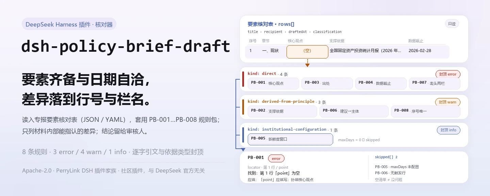
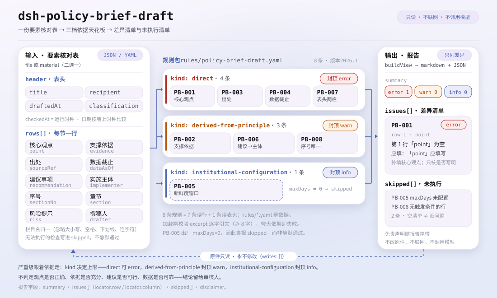

<div align="center">

<picture>
  <source media="(prefers-color-scheme: dark)" srcset="docs/assets/dsh-policy-brief-draft-hero-zh-dark.webp">
  
</picture>

# dsh-policy-brief-draft

**逐行核对政策专报的要素齐备与数据新鲜度——输出「哪一行、哪一栏、差什么」的清单，结论留给审核人。**

面向政策研究人员与办公室写手的 DeepSeek Harness 检查插件：读入一份专报要素核对表（文件表头加每节一行），套用逐条引文的规则包（PB-001…PB-008），只列材料内部能逐条指认的差异，不改原件、不联网、不调用模型。

[安装](#三步上手) · [配置](#配置) · [FAQ](#faq) · [简体中文](README.md) · [English](README.en.md) · [Español](README.es.md) · [Português](README.pt.md) · [हिन्दी](README.hi.md)

[](LICENSE)
[](#兼容性)
[](https://www.npmjs.com/package/dsh-policy-brief-draft)
[](https://github.com/PerryLink/dsh-policy-brief-draft/actions/workflows/ci.yml)
[](#兼容性)

[](https://github.com/PerryLink/dsh-policy-brief-draft/stargazers)
[](https://www.npmjs.com/package/dsh-policy-brief-draft)
[](https://dshfind.com/plugins/PerryLink/dsh-policy-brief-draft?ref=badge)
[](https://securityscorecards.dev/viewer/?uri=github.com/PerryLink/dsh-policy-brief-draft)
[](https://dsh.market/)
[](https://gitee.com/perrylink/dsh-policy-brief-draft)

```sh
dsh plugin --profile <name> add dsh-policy-brief-draft
```

</div>

<sub>社区插件，与 DeepSeek 官方无关。唯一仓库：<https://github.com/PerryLink/dsh-policy-brief-draft>（Gitee 为镜像）。</sub>

## 它是什么

`dsh-policy-brief-draft` 读取一份政策专报（或研究报告）要素核对表——文件表头加上每节一行——核对这份表自身的齐备与自洽：每节是否写明核心观点、观点是否有支撑依据、依据是否注明出处、数据截止日期是否可解析且不晚于核对日、数据是否落在你配置的新鲜度窗口内、建议事项是否写明实施主体、表头是否声明专报标题与报送对象、要点序号是否重复。它返回一份「哪一行、哪一栏、差什么」的差异清单，不改原件、不联网、不调用模型；不判定观点是否正确、依据是否充分、建议是否可行、数据是否可靠、专报是否应当报送——那是研究质量与决策价值的判断，也是本插件刻意不碰的部分。

<picture>
  <source media="(prefers-color-scheme: dark)" srcset="docs/assets/dsh-policy-brief-draft-flow-v5-dark.svg">
  
</picture>

## 三步上手

1. **安装**：

   ```sh
   dsh plugin --profile <name> add dsh-policy-brief-draft
   ```

   也可以在 WorkBuddy / 扣子搜「文书与治理核对包」（本检查是其中一项；上架以商城为准）。

2. **最小配置**（默认即可用）：

   ```yaml
   - insert:
       - id: dsh-policy-brief-draft
         name: dsh-policy-brief-draft
   ```

   全部可调项都在 `src/config.ts` 的 Schemastery schema 里，默认值开箱即用；逐条阈值在 `rules/` 下的规则包里。

3. **验证已生效**：

   ```sh
   dsh --profile <name> --dump-config | grep 'dsh-policy-brief-draft'
   ```

   再用自带样例跑一次（约 1 分钟）：

   ```sh
   node samples/quickstart/run.mjs
   ```

   ```text
   $ node samples/quickstart/run.mjs
   policy_brief_draft: 1 issue(s) — error 1, warn 0, info 0
   skipped: 2
   ```

   样例输入在 `samples/quickstart/input/`，期望输出在 `samples/quickstart/expected/result.json`，首次运行的终端截图见 [`docs/assets/quickstart.png`](docs/assets/quickstart.png)。

**卸载**：`dsh plugin --profile <name> remove dsh-policy-brief-draft`（或从 profile patch 删掉该行）。

## 核心能力

本插件注册 `policy_brief_draft` 工具：读入一份专报要素核对表（表头加每节一行），套用带版本的规则包，返回一份结构化报告。材料为 JSON 或 YAML；无法执行的检查会列在 `skipped` 中，并写明原因。

- **规则包即数据** —— 8 条检查全部在 `rules/policy-brief-draft.yaml` 里，换规则不动代码；规则包在加载期校验，而非被信任。
- **严重级跟着依据走** —— 依据为原则性条款（`derived-from-principle`）的规则封顶 `warn`，依据为本机构配置（`institutional-configuration`）的封顶 `info`；绝不会把原则或本地配置标成 `error`（有测试断言）。
- **空清单不等于没问题** —— 每一项无法执行的检查都会在 `skipped` 里自报原因；`PB-005` 的 `maxDays` 出厂为 `0`，因此它自报 `skipped`，而不是静默通过。
- **不裁决** —— 报告只列差异，永不判定合规、责任或对错；措辞守卫强制报告始终携带免责声明。
- **引文不伪造** —— 每条规则带 `document` / `number` / `clause` / `excerpt` / `kind` / `source`；`excerpt` 必须是逐字引文，取不到就明说，绝不把转述包装成引文。

```text
专报要素表（JSON/YAML）──policy_brief_draft──▶ 规则包 PB-001…PB-008 ──▶ 报告（issues + skipped）
          ▲                                                                        │
          └──────────────────────────── 原件只读，永不修改 ─────────────────────────┘
```

### 规则一览

| 规则 | 核对内容 | 严重级 | 依据类型 |
|---|---|---|---|
| `PB-001` | 每节写明核心观点 | error | 逐字条文 |
| `PB-002` | 每个观点都有支撑依据 | warn | 原则性推论 |
| `PB-003` | 依据注明出处 | error | 逐字条文 |
| `PB-004` | 数据截止日期可解析，且不晚于核对日 | error | 逐字条文 |
| `PB-005` | 数据落在你配置的新鲜度窗口内（默认关闭） | info | 本机构配置 |
| `PB-006` | 建议事项写明实施主体 | warn | 原则性推论 |
| `PB-007` | 专报声明标题与报送对象 | warn | 逐字条文 |
| `PB-008` | 要点序号在表内唯一 | warn | 原则性推论 |

### 示例

以下为插件真实入口；安装后调用一次即可。该输出取自插件对自己 `PB-001` 测试夹具的运行结果，不是示意图。

**详细输出** — 工具 `policy_brief_draft`，输入：

```json
{"title":"某某领域投资形势分析专报","rows":[{"序号":"1","章节":"一、现状","核心观点":"","支撑依据":"全国固定资产投资统计月报（2026 年 2 月）显示本领域投资同比增长 3.1%"}]}
```

输出：

```json
{
  "id": "dsh-policy-brief-draft.PB-001.de09b5a6",
  "ruleId": "PB-001",
  "severity": "error",
  "locator": {
    "row": 1,
    "field": "point"
  },
  "found": "第 1 行「point」为空",
  "expected": "「point」应填写",
  "fix": "补填核心观点；本条只核对是否写明，不判断观点是否成立"
}
```

*Observed from `dsh-policy-brief-draft/tests/fixtures/PB-001/PB-001-unsafe.json (cases.json expects 1×PB-001); executed parseMaterial+runCheck, checkedAt=2026-10-06T00:00:00.000Z`*

### 它回答什么问题

| 你会问 | 它怎么答 |
|---|---|
| 有一节全是材料、没有结论，观点栏是空的。 | `PB-001` 会报出这一节：每节都应写明核心观点。它只核对 `point` 栏是否填写，因此不判断观点是否正确、是否有新意。本条为 `error`：第十九条（三）明文要求「观点鲜明」，该条已于 2026-10-13 逐字取得。 |
| 依据栏和出处栏都填了，插件到底核对了什么？ | 只核对这两栏是否填写。`PB-002` 要求每个观点都有 `evidence`，`PB-003` 要求其旁注明 `sourceRef`。`PB-003` 为 `error`：第二十条（四）把「引文等是否准确」列为签发前审核重点；`PB-002` 仍为 `warn`，因为没有条文要求「每个观点必须附一条依据」。`PB-002` 不判断依据是否充分、是否真实、是否支持该观点；`PB-003` 不能核对出处是否存在、数据是否与出处一致——插件读的是核对表本身，从不读被引材料，编造的出处也会通过。 |
| 数据截止日期写成 `2026-03-15 09:30`，另有一节写的是晚于今天的日期。 | `2026-03-15` 与 `2026-03-15 09:30` 两种写法都能识别。`PB-004` 报出晚于核对日的 `dataAsOf`，即日期填错了或引用了尚未产生的数据；本条为 `error`：第十九条（二）要求「分析问题实事求是」、第二十条（四）要求「时间」准确，而晚于核对日的截止日期在事实上不可能成立。解析不了的值单独报出，不会静默跳过。数据本身是否可靠，它不判断。 |
| 新鲜度那条报的是 `skipped`，是不是说明数据没问题？ | 不是。`PB-005` 出厂 `maxDays: 0`，即未配置，于是它报告自身进入 `skipped`，而不是自己编一个天数；配置 `maxDays`（例如 `maxDays: 90`）才会启用。命中只表示数据比你配置的窗口更旧，不表示数据不可用——引用旧数据有时是必要的，请在备注里说明原因。本条为 `info`（其天数窗口取自本机构编辑口径，条例不规定任何天数）。 |
| 有一节写了建议，但没写由谁来实施。 | `PB-006` 会报出这一节：`recommendation` 栏一旦填写，就要求填写 `implementer` 栏。只作现状分析、不提建议的节不会被报出，本条不会去打扰这类节。它只核对实施主体是否填写，不判断建议是否可行、主体是否恰当。 |
| 专报本身要声明什么？同一序号能在表里出现两次吗？ | `PB-007` 要求表头声明 `title` 与 `recipient` 两项，如果你的表式还记录密级或专题，把它们加进它的 `fields` 即可。`PB-008` 报出表内重复出现的 `sectionNo`，比较时忽略空白字符，因为序号重复会让评审意见无法准确指认要点。`PB-007` 只核对表头这两栏是否填写，不判断标题是否贴切、报送对象是否恰当；`PB-008` 只比对序号本身。 |

## 配置

全部可调参数都在 `src/config.ts` 的 Schemastery schema 中，只改 `cordis.yml` 即可生效，无需改代码；逐条阈值在 `rules/` 下的规则库文件里。全部配置键即下表 5 个；规则级参数见表后。

| 键 | 类型 | 默认值 | 说明 |
|---|---|---|---|
| `rulesFile` | string | `rules/policy-brief-draft.yaml` | 规则库文件路径，相对插件包根目录 |
| `disabledRules` | string[] | `[]` | 要停用的规则 id 列表；每条都会出现在 `skipped` 中 |
| `onlyRules` | string[] | `[]` | 只执行这些规则 id；留空表示执行全部规则 |
| `skipNotes` | string | `""` | 附加到每条 `skipped` 说明后的备注 |
| `timeoutMs` | number | `120000` | 工具协作式超时预算（毫秒） |

值得知道的规则级参数：

- `PB-005` `maxDays` —— 你的新鲜度窗口（天）。`0` 表示本条不执行，并出现在 `skipped` 中。
- `PB-006` `conditionField` / `requiredFields` —— 触发实施主体要求的条件；默认是「建议」栏。只作现状分析、不提建议的节不会被要求填写实施主体。
- `PB-007` `fields` —— 表头必须存在的字段；默认 `title` 与 `recipient`。若专报带密级，可加入 `classification`。

## FAQ

<details>
<summary>我的材料会被改动或上传吗？</summary>

不会。工具只读取你交出的 JSON/YAML 材料文本，**绝不修改原件**；插件是纯 ESM、无原生代码、**不联网、不调用模型**（见「兼容性」），材料不离开你的机器。

</details>

<details>
<summary>没配新鲜度窗口时，会不会静默通过？</summary>

不会。`PB-005` 的 `maxDays` 出厂为空（`0`），规则会把自己报进 `skipped` 并写明原因——空的差异清单不会被读成「没有缺项」。配置 `maxDays` 后它才开始运行；此后命中只表示数据比你设置的窗口更旧，不表示数据不可用。

</details>

<details>
<summary>插件装上了但工具不出现，怎么办？</summary>

确认 `main` 指向 `lib/index.mjs` 且 `pnpm run build` 已生成该文件；`main` 写错会让加载器静默跳过该条目。

</details>

<details>
<summary>安装时被判版本不兼容，怎么办？</summary>

peer 范围覆盖 `0.1.x` 与 `0.2.x`；若你的运行时在其之外，可显式豁免：`dsh plugin --profile <name> allow-version dsh-policy-brief-draft@0.1.0 --dsh-version <runtime> --accept-risk`。安装期的 peer 校验以运行时为准。

</details>

<details>
<summary>一整份材料或整个目录批量核，跑得动吗？</summary>

工具在 `native` 与 `ptc` 两种模式下都可用；批量校验整个目录时建议 `ptc`，schema 成本只付一次。全部计算都是对输入字符串做墙上时钟运算，不做时区换算。

</details>

## 依据的标准

| 文件 | 文号 | 引用它的规则 |
|---|---|---|
| 《党政机关公文处理工作条例》 | 中办发〔2012〕14号（全文已取得，逐字回填至各条 `excerpt`） | PB-001, PB-002, PB-003, PB-004, PB-005, PB-006, PB-007, PB-008 |

**边界：** 本插件核对一份 **政策专报要素核对表** 中可以机械要求到的事项——每节是否写明核心观点，观点是否有支撑依据，依据是否注明出处，数据截止日期是否可解析且不在未来，数据在你配置的窗口内是否足够新鲜，建议事项是否写明实施主体，专报是否写明标题与报送对象，以及要点序号是否唯一。它**不**判定观点是否正确、依据是否充分、建议是否可行、数据是否可靠，或专报是否应当报送。**这些是关于研究质量与决策价值的判断。**

> ### ⚠️ 本插件能看到什么、不能看到什么
>
> **它读的是一份核对表，而不是出处或数据本身。** 因此它只能核对某个出处是否被*引用*——永远不能核对该出处是否存在，也不能核对数据是否与它一致。`PB-003` 在自身的 note 中写明了这一点，README 的排障一节也重申：编造的出处照样会通过，因为核实出处是另一件工作。
>
> **《党政机关公文处理工作条例》（中办发〔2012〕14号）已取得并逐字读过**，`rules/evidence/clause-verification.md` 记录了引用了哪些条文——第八条第（十）项（报告用于向上级机关汇报工作）、第十九条（起草：「分析问题实事求是」「所提政策措施和办法切实可行」「观点鲜明」）以及第二十条第（四）项，该项把「引文等是否准确」列为签发前的审核重点。
>
> **条款原文现已进入规则库，严重级也据此重新推导（2026-10-13）。** 该条例规范的是文件如何*起草与签发*；本插件核对的是专报的*提纲*是否记录了其观点、依据、出处与建议。这是两回事，因此规则是逐条套用的，而不是整批套用：
>
> - **条文明文写出该检查所寻找的要求之处时，提升为 `error`**：`PB-001`（19(3)「观点鲜明」）、`PB-003`（20(4) 把「引文等是否准确」列为签发前审核重点）与 `PB-004`（19(2)「分析问题实事求是」配合 20(4)「时间」——晚于核对日的截止日期不可能成立）。
> - **即使已取得原文，仍保持在 `warn`**，因为该条文讲的是另一件事：`PB-002`（没有条文要求每个观点必须附一条引文）、`PB-006`（没有条文要求写明实施主体）、`PB-008`（没有条文要求序号唯一），以及 **`PB-007`**——其第九条规范的是正式公文的十八个格式要素，而不是一份工作提纲的两栏：把一个空白的表头单元格说成对第九条的 `direct` 违反，等于把登记上的缺口包装成违规。
> - **仍为 `info`**：`PB-005`，其窗口是你的编辑口径，条例中完全没有这项规定。
>
> 因此**3 条规则为 `error`、4 条为 `warn`、1 条为 `info`**——这种划分本身就是要点，不是折中：取得原文，只在原文确实写到了被核对之事的地方，才允许作 `direct` 引用。见 `rules/evidence/` 下的 `clause-verification-gongwen-tiaoli-direct.md`，该文件也记录了它与 `clause-verification.md` 中早先分析不一致之处。
>
> **数据新鲜度窗口出厂时未设置。** 多旧算太旧是你的编辑口径——一份快报可能要求上个月的数据，而一份年度分析引用全年数据也属正当——因此 `PB-005` 的 `maxDays` 从 `0` 起步，该规则会把自己记入 `skipped`，而不是编一个天数。此项命中意味着「比你设置的窗口更旧」，从不意味着「不可用」；引用较旧的数据有时是对的，解决办法是在备注中说明原因。

## 材料格式

工具接受 JSON 或 YAML：

```yaml
title: 某某领域投资形势分析专报
topic: 投资形势
recipient: 某某部门
draftedAt: 2026-03-12
classification: 内部
rows:
  - { 序号: '1', 章节: 一、现状,
      核心观点: 本领域投资增速连续三个季度回落，结构性分化明显,
      支撑依据: 全国固定资产投资统计月报（2026 年 2 月）显示本领域投资同比增长 3.1%,
      出处: 国家统计局月度数据，2026 年 3 月发布, 数据截止日期: 2026-02-28,
      风险提示: 月度数据存在季节因素，需结合同比口径判断 }
```

栏目名在比对时忽略大小写、空格、下划线与连字符；报告沿用清单自己的栏目名，因此每条发现都会指名它读的那一栏。日期可以写成 `2026-02-28` 或 `2026-02-28 09:30`。字段在读取层是可选的，由检查引擎校验，因此部分导出的材料会产生「缺项」类差异，而不是让程序崩溃。

## 规则来源

规则数据在 `rules/policy-brief-draft.yaml`，与代码分离。每条规则携带文件名、文号、按原文自身编号体系的条款号、逐字摘录（`excerpt`）与来源链接，并标注依据类型（`kind`）。加载期强制：`excerpt` 必须是真实引文且不少于八个字符；依据仅为原则性条款（`derived-from-principle`，严重级上限 `warn`）或本机构配置（`institutional-configuration`，上限 `info`）的检查不得标为 `error`。夸大依据的规则库会在加载期失败，而不会产出一份看起来很有底气的报告。

所引条款来自《党政机关公文处理工作条例》（中办发〔2012〕14号）：第八条第（十）项、第九条（含（七）标题、（八）主送机关）、第十九条（二）（三）、第二十条（四）。核验中确认的边界与「刻意没有作出的结论」见 `rules/evidence/`，尤其是 `clause-verification-gongwen-tiaoli-direct.md` 与 `clause-verification.md`。

## 兼容性

| 项目 | 状态 |
|---|---|
| Harness | 对等版本范围 `>=0.1.2-rc.1 <0.2.0 \|\| >=0.2.0-0 <0.3.0`——已实测同时接受 `0.2.0-rc.2` 与 `0.2.1-rc.2`。已声明 `engines.dsh`：`>=0.2.1-0 <0.3.0`，0.2.1 起由宿主单独裁决 |
| Node | `^22.19.0 \|\| >=24.0.0` |
| 平台 | 全平台（纯 ESM；无原生代码、无联网、不调用模型） |
| 工具模式 | `native` / `ptc` 均可；批量校验整个目录时建议 `ptc`，schema 成本只付一次 |

## 故障排查

- **`PB-005` 从不执行。** 新鲜度窗口为空（`maxDays: 0`）。多旧算太旧是你的编辑口径，插件不会替你指定；配置 `maxDays`（例如 `90`）即可启用。
- **`PB-003` 放过了我明知是编造的出处。** 它无法核对这一点：它只核对某个出处是否被*引用*，不核对该出处是否存在、是否说了专报声称的内容。
- **`PB-005` 对我有意引用的旧数据仍报出。** 旧数据有时正是对的数据。请放宽 `maxDays` 或在备注里记录原因——这条发现针对的是窗口，不是数据本身。
- **`PB-006` 对分析性章节不报出。** 这是刻意的：只有确实写了建议，才要求写明实施主体。
- **`PB-004` 对未来日期报出。** 数据截止日期或成文日期中必有一个填错；专报不能建立在尚未产生的数据上。
- **插件装上了但工具不出现。** 确认 `main` 指向 `lib/index.mjs` 且 `pnpm run build` 已生成该文件；`main` 写错会让加载器静默跳过该条目。
- **`dsh plugin add` 以不兼容为由拒绝。** peer 范围覆盖 `0.1.x` 与 `0.2.x`；若运行时在其之外，可显式豁免：`dsh plugin --profile <name> allow-version dsh-policy-brief-draft@0.1.0 --dsh-version <runtime> --accept-risk`
- **某条规则没有执行。** 查看 `skipped` 数组，其中写明了规则 id 与原因。
- **`check` 报 `manifest-peers` 失败。** 静态检查器比对的是一份早于 0.2 世代的硬编码 peer 范围；安装期的 peer 校验以运行时为准。这是 `dsh-plugin-dev` 的已知上游问题。
- **时间看起来偏移。** 全部计算都是对输入字符串做墙上时钟运算，不做时区换算。

## 生态与质量

- [Gitee 镜像](https://gitee.com/perrylink/dsh-policy-brief-draft)（同步镜像，以 GitHub 为准）
- [dshfind 插件页](https://dshfind.com/plugins/PerryLink/dsh-policy-brief-draft)（安装量与排名）
- [OpenSSF Scorecard 报告](https://securityscorecards.dev/viewer/?uri=github.com/PerryLink/dsh-policy-brief-draft)（由 [.github/workflows/scorecard.yml](.github/workflows/scorecard.yml) 驱动）
- [DSH Market](https://dsh.market/)（已上架）
- [生态实测知识库 · 按材料选核查器](https://perrylink.github.io/zh/checkers/choose/)（完整家族清单：核查器 + 通用插件）

## 开发

```sh
pnpm install
pnpm run typecheck   # tsc --noEmit
pnpm test            # vitest，每条规则配对正/反夹具（tests/fixtures/<RULE>/）
pnpm run build       # tsdown -> lib/index.mjs + lib/index.d.mts
pnpm run check:readmes   # 五语 README 一致性
node ../scripts/sync-shared.mjs dsh-policy-brief-draft   # 从 ../_shared 刷新 src/shared
```

插件是 data-only：`src/model.ts` 声明表形，共享 kit 提供读取器与检查引擎，规则包声明每一条检查。规则包是数据不是代码：改 `rules/*.yaml` 即切换规则集，无需动 TypeScript；规则包在加载期校验，而非被信任。README 配图由 [`scripts/gen-readme-assets.py`](scripts/gen-readme-assets.py) 程序化生成（Python + Pillow），可重复执行；本插件无 UI，hero 为程序合成的 1440×576 横幅（中英 × 深浅四版），结构图 `docs/assets/dsh-policy-brief-draft-flow-v5-light.svg` 为手写 SVG（深浅双版，图内仅命令面 token）。

Topics：`dsh`, `dsh-plugin`, `deepseek-harness`, `cordis`, `policy`, `brief`, `draft`

## 家族与致谢

本项目是 [PerryLink](https://github.com/PerryLink) 维护的 DeepSeek Harness 插件家族成员（全部 Apache-2.0）。如果这个插件帮到了你，**给个 star**——它不解锁任何功能，但会让下一个人更容易找到它。

- [@PerryLink](https://github.com/PerryLink) —— 创建者与维护者：`policy_brief_draft` 工具、逐字引文的规则包与条款核验记录、五语文档。

<details>
<summary>展开全部插件</summary>

| 插件 | 状态 |
|---|---|
| **[dsh-aqua-input-check](https://github.com/PerryLink/dsh-aqua-input-check)** |  |
| **[dsh-archive-check](https://github.com/PerryLink/dsh-archive-check)** |  |
| **[dsh-auto-review](https://github.com/PerryLink/dsh-auto-review)** |  |
| **[dsh-autotier](https://github.com/PerryLink/dsh-autotier)** | 🧊 已冻结 — 见仓库 README |
| **[dsh-bid-ca-precheck](https://github.com/PerryLink/dsh-bid-ca-precheck)** |  |
| **[dsh-bid-qual-check](https://github.com/PerryLink/dsh-bid-qual-check)** |  |
| **[dsh-cert-mcp](https://github.com/PerryLink/dsh-cert-mcp)** | 🧊 已冻结 — 见仓库 README |
| **[dsh-checkpoint-rewind](https://github.com/PerryLink/dsh-checkpoint-rewind)** |  |
| **[dsh-click](https://github.com/PerryLink/dsh-click)** |  |
| **[dsh-composer-history](https://github.com/PerryLink/dsh-composer-history)** |  |
| **[dsh-contract-stance](https://github.com/PerryLink/dsh-contract-stance)** |  |
| **[dsh-customs-doc-check](https://github.com/PerryLink/dsh-customs-doc-check)** |  |
| **[dsh-data-quality](https://github.com/PerryLink/dsh-data-quality)** | 🧊 已冻结 — 见仓库 README |
| **[dsh-demurrage-ledger](https://github.com/PerryLink/dsh-demurrage-ledger)** |  |
| **[dsh-doublecheck](https://github.com/PerryLink/dsh-doublecheck)** |  |
| **[dsh-drill-script-check](https://github.com/PerryLink/dsh-drill-script-check)** |  |
| **[dsh-eia-guide-check](https://github.com/PerryLink/dsh-eia-guide-check)** |  |
| **[dsh-emergency-plan](https://github.com/PerryLink/dsh-emergency-plan)** |  |
| **[dsh-essay-rubric-check](https://github.com/PerryLink/dsh-essay-rubric-check)** |  |
| **[dsh-evidence-check](https://github.com/PerryLink/dsh-evidence-check)** |  |
| **[dsh-export-ctl-check](https://github.com/PerryLink/dsh-export-ctl-check)** |  |
| **[dsh-fast](https://github.com/PerryLink/dsh-fast)** |  |
| **[dsh-fmea-table-check](https://github.com/PerryLink/dsh-fmea-table-check)** |  |
| **[dsh-forecast-penalty](https://github.com/PerryLink/dsh-forecast-penalty)** |  |
| **[dsh-fund-research](https://github.com/PerryLink/dsh-fund-research)** |  |
| **[dsh-github](https://github.com/PerryLink/dsh-github)** |  |
| **[dsh-gongwen-flow-check](https://github.com/PerryLink/dsh-gongwen-flow-check)** |  |
| **[dsh-gongwen-word-check](https://github.com/PerryLink/dsh-gongwen-word-check)** |  |
| **[dsh-guard-plan-qc](https://github.com/PerryLink/dsh-guard-plan-qc)** |  |
| **[dsh-hazchem-check](https://github.com/PerryLink/dsh-hazchem-check)** |  |
| **[dsh-hazplan-check](https://github.com/PerryLink/dsh-hazplan-check)** |  |
| **[dsh-hidden-risk-map](https://github.com/PerryLink/dsh-hidden-risk-map)** |  |
| **[dsh-hs-classify](https://github.com/PerryLink/dsh-hs-classify)** |  |
| **[dsh-icd-rule-check](https://github.com/PerryLink/dsh-icd-rule-check)** |  |
| **[dsh-industry-research](https://github.com/PerryLink/dsh-industry-research)** |  |
| **[dsh-lawcite-adapter](https://github.com/PerryLink/dsh-lawcite-adapter)** |  |
| **[dsh-laya](https://github.com/PerryLink/dsh-laya)** |  |
| **[dsh-lc-doc-check](https://github.com/PerryLink/dsh-lc-doc-check)** |  |
| **[dsh-learning-gap-check](https://github.com/PerryLink/dsh-learning-gap-check)** |  |
| **[dsh-library](https://github.com/PerryLink/dsh-library)** |  |
| **[dsh-local-ai](https://github.com/PerryLink/dsh-local-ai)** |  |
| **[dsh-lsp-actions](https://github.com/PerryLink/dsh-lsp-actions)** |  |
| **[dsh-mask](https://github.com/PerryLink/dsh-mask)** |  |
| **[dsh-mcp-panel](https://github.com/PerryLink/dsh-mcp-panel)** |  |
| **[dsh-medrec-qc](https://github.com/PerryLink/dsh-medrec-qc)** |  |
| **[dsh-memento](https://github.com/PerryLink/dsh-memento)** |  |
| **[dsh-nsfc-form-check](https://github.com/PerryLink/dsh-nsfc-form-check)** |  |
| **[dsh-nurse-record-check](https://github.com/PerryLink/dsh-nurse-record-check)** |  |
| **[dsh-observe](https://github.com/PerryLink/dsh-observe)** |  |
| **[dsh-origin-rvc-check](https://github.com/PerryLink/dsh-origin-rvc-check)** |  |
| **[dsh-ota-review-check](https://github.com/PerryLink/dsh-ota-review-check)** |  |
| **[dsh-output-styles](https://github.com/PerryLink/dsh-output-styles)** |  |
| **[dsh-paper-doc-adapter](https://github.com/PerryLink/dsh-paper-doc-adapter)** |  |
| **[dsh-permission-rules](https://github.com/PerryLink/dsh-permission-rules)** |  |
| **[dsh-permit-report-check](https://github.com/PerryLink/dsh-permit-report-check)** |  |
| **[dsh-pipeline-check](https://github.com/PerryLink/dsh-pipeline-check)** |  |
| **[dsh-pleading-draft](https://github.com/PerryLink/dsh-pleading-draft)** |  |
| **[dsh-plugin-doctor](https://github.com/PerryLink/dsh-plugin-doctor)** | 🚫 已退役（仓库已归档） |
| **[dsh-plugin-guide](https://github.com/PerryLink/dsh-plugin-guide)** |  |
| **[dsh-plugin-kit](https://github.com/PerryLink/dsh-plugin-kit)** | 🚫 已退役（仓库已归档） |
| **[dsh-plugin-upgrade](https://github.com/PerryLink/dsh-plugin-upgrade)** | 🚫 已退役（仓库已归档） |
| **[dsh-policy-brief-draft](https://github.com/PerryLink/dsh-policy-brief-draft)** |  |
| **[dsh-power-loss-split](https://github.com/PerryLink/dsh-power-loss-split)** |  |
| **[dsh-power-ticket-check](https://github.com/PerryLink/dsh-power-ticket-check)** |  |
| **[dsh-ppap-check](https://github.com/PerryLink/dsh-ppap-check)** |  |
| **[dsh-protest-deadline](https://github.com/PerryLink/dsh-protest-deadline)** |  |
| **[dsh-railway-window](https://github.com/PerryLink/dsh-railway-window)** |  |
| **[dsh-repair-order-qc](https://github.com/PerryLink/dsh-repair-order-qc)** |  |
| **[dsh-research-report](https://github.com/PerryLink/dsh-research-report)** |  |
| **[dsh-review-reply-check](https://github.com/PerryLink/dsh-review-reply-check)** |  |
| **[dsh-rulefile-check](https://github.com/PerryLink/dsh-rulefile-check)** |  |
| **[dsh-safety-brief-check](https://github.com/PerryLink/dsh-safety-brief-check)** |  |
| **[dsh-score](https://github.com/PerryLink/dsh-score)** | 🧊 已冻结 — 见仓库 README |
| **[dsh-session-sync](https://github.com/PerryLink/dsh-session-sync)** |  |
| **[dsh-site-log-check](https://github.com/PerryLink/dsh-site-log-check)** |  |
| **[dsh-skill-pack-security](https://github.com/PerryLink/dsh-skill-pack-security)** |  |
| **[dsh-soe-decision-check](https://github.com/PerryLink/dsh-soe-decision-check)** |  |
| **[dsh-soilwater-check](https://github.com/PerryLink/dsh-soilwater-check)** |  |
| **[dsh-sop-sync-check](https://github.com/PerryLink/dsh-sop-sync-check)** |  |
| **[dsh-spc-gbt-adapter](https://github.com/PerryLink/dsh-spc-gbt-adapter)** |  |
| **[dsh-talk](https://github.com/PerryLink/dsh-talk)** |  |
| **[dsh-tender-extract](https://github.com/PerryLink/dsh-tender-extract)** |  |
| **[dsh-tender-matrix](https://github.com/PerryLink/dsh-tender-matrix)** |  |
| **[dsh-test-drive](https://github.com/PerryLink/dsh-test-drive)** |  |
| **[dsh-ticktick](https://github.com/PerryLink/dsh-ticktick)** | 🚫 已退役（仓库已归档） |
| **[dsh-translate](https://github.com/PerryLink/dsh-translate)** |  |
| **[dsh-warranty-calc](https://github.com/PerryLink/dsh-warranty-calc)** |  |
| **[dsh-budget](https://github.com/PerryLink/dsh-budget)** | 🧊 已冻结 — 见仓库 README |
| **[dsh-claude-move](https://github.com/PerryLink/dsh-claude-move)** | 🧊 已冻结 — 见仓库 README |
| **[dsh-defend](https://github.com/PerryLink/dsh-defend)** | 🧊 已冻结 — 见仓库 README |
| **[dsh-draw](https://github.com/PerryLink/dsh-draw)** | 🧊 已冻结 — 见仓库 README |
| **[dsh-reach](https://github.com/PerryLink/dsh-reach)** | 🧊 已冻结 — 见仓库 README |
| **[dsh-background-agents](https://github.com/PerryLink/dsh-background-agents)** | 🚫 已退役（仓库已归档） |
| **[dsh-session-pin](https://github.com/PerryLink/dsh-session-pin)** | 🚫 已退役（仓库已归档） |
| **[dsh-team-rooms](https://github.com/PerryLink/dsh-team-rooms)** | 🚫 已退役（仓库已归档） |

</details>

## License

[LICENSE](LICENSE)（Apache License 2.0）© 2026 dsh-policy-brief-draft contributors

<p align="center"><sub>Apache-2.0 · 社区插件，与 DeepSeek 无关。</sub></p>
